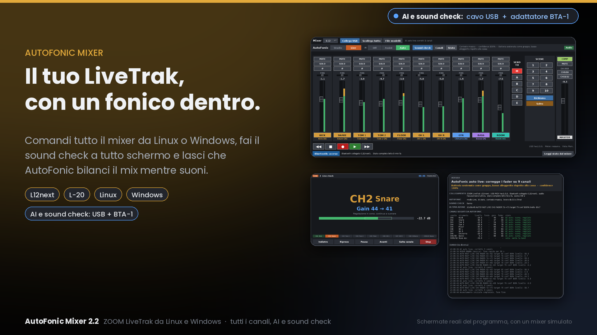
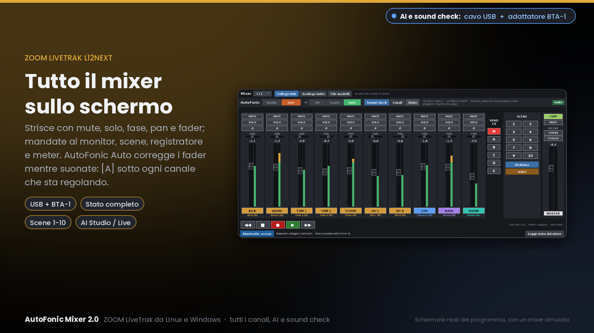
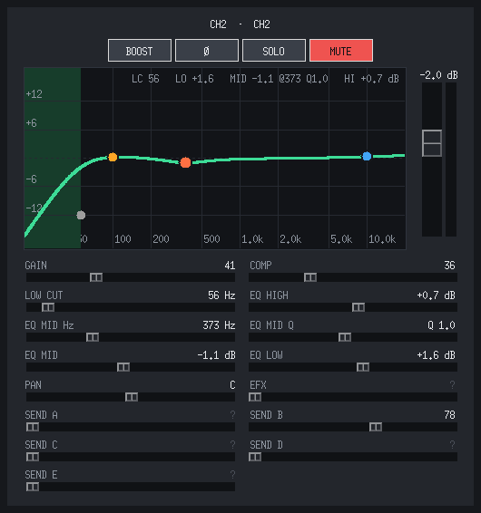
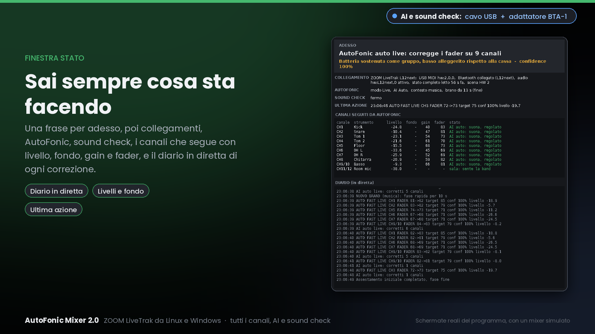
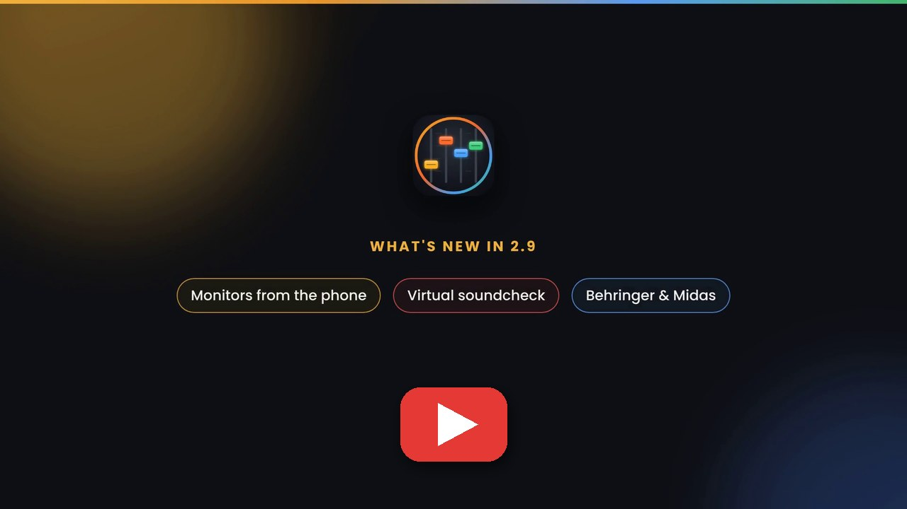

# 🎛️ AutoFonic Mixer

### Your ZOOM LiveTrak, with a sound engineer inside
**L12next · L-20 / L-20R · L6 / L6max** — from your **PC** (Windows, Linux, Mac) and your **Android phone**

*[Italiano più sotto](#italiano)*

AutoFonic Mixer controls your LiveTrak from your **computer** or **phone**, runs a **full-screen sound check**
(readable even from behind the drums) and **balances the mix while you play**, listening to the audio of
every channel.  In **10 languages**.

🌐 **Website:** https://francescorizzo-cyber.github.io/autofonic-mixer/

**The ZOOM LiveTrak app for Android and PC.**  ZOOM's own control apps (L-20 Control, L-12 Control) run only on
iPhone and iPad: AutoFonic Mixer is the **ZOOM L-20 / L-20R app for Android**, the **L12next remote control for
Android**, and a **LiveTrak controller for Windows, Linux and Mac**.  Get it on
**[Google Play](https://play.google.com/store/apps/details?id=com.autofonic.mixer)**.

## ⬇️ Download — free demo

Tap the button for your system: the download of the **latest version** starts right away.

| System | Download | Notes |
|---|---|---|
| 🤖 **Android** 8+ |  | 7-day full trial, then a one-time purchase · or the [APK file](https://github.com/francescorizzo-cyber/autofonic-mixer/releases/latest/download/AutoFonicMixer-DEMO-android.apk) |
| 🪟 **Windows** 10 / 11 |  | install the **ZOOM driver** of your mixer first |
| 🐧 **Linux** (Ubuntu / Debian) |  | unpack, then `sh installa.sh` |
| 🍎 **Mac** (Apple Silicon) |  | first time: right click → Open · not tested with a real mixer yet |

Release notes and older versions: **[all releases](../../releases)**.  Full PC version: see [below](#full-version).

## 🎚️ Supported mixers — all tested on real mixers ✅

| Mixer | Connection | PC | Android |
|---|---|---|---|
| **L12next** | USB + ZOOM BTA-1 Bluetooth | ✅ works | ✅ works |
| **L-20 / L-20R** | USB + ZOOM BTA-1 Bluetooth | ✅ works — all controls | ✅ works — all controls |
| **L6 / L6max** | USB-C cable, or **wireless** with a CME WIDI Jack | ✅ works | ✅ works |

**All controls** means faders, pan, mute, solo, EQ, low cut, sends, stereo channels, effect returns, scenes,
recorder (with its time) and meters — every one tried by users on their own mixer
(L-20: [Alan](#-contributors) · L6: [Gabriele](#-contributors)).  The L-8 cannot be controlled: it has neither
MIDI nor the BTA-1.

> 💬 Feedback, problems, ideas: **[open an issue](https://github.com/francescorizzo-cyber/autofonic-mixer/issues/new/choose)** (free GitHub account) or write to **autofonic.mixer@gmail.com**.

## 💻 On the PC (Windows · Linux · Mac)

- **The whole mixer on screen**: faders, mute, solo, phase, pan, meters, monitor sends, scenes, recorder.
- **Channel page** 🆕: EQ curve, fader with meter, values in dB and Hz (click the channel name).
- **Full-screen sound check** in 4 phases: room silence, one instrument at a time (gain, sound, drum phase),
  the whole band (faders get balanced), saved to the scene you choose.
- **AI Studio / Live**: *Assist* suggests, *Auto* corrects the faders while you play, with the right rules for
  each instrument.  An optional room mic also listens to the room.
- **SD export**: the recordings on the SD card become WAV tracks named after the channel, plus the master and
  a stereo mix, in WAV or MP3.
- **Tuner** for guitar, bass and drums.
- **Respects your mixer**: never changes scene by itself, never touches monitor sends or master.

Sound check and AI need the **USB cable** (it carries every channel's audio) and, on L12next and L-20, the **BTA-1**.

| | |
|---|---|
|  |  |
|  |  |

## 📱 On Android

**[AutoFonic Mixer on Google Play](https://play.google.com/store/apps/details?id=com.autofonic.mixer)**: your phone becomes the mixer's remote control, right from the stage.

- Faders, mute, solo, pan, monitor sends, channel page with EQ and curve, scenes
- 🎤 **feedback finder** with the phone mic · 🎸 **tuner** · 💾 **saved setups**
- 🎧 **musician mode**: each player controls only their own monitor mix · 🔗 **stereo link** · 🔒 **touch lock**
- 7-day free trial, then a one-time purchase

## ▶️ Watch the video

## 🔑 Full PC version

The PC download is a **free demo**: everything works for 14 days.  **Full version: €9.99, one time only**, valid forever on
that PC — pay at **[paypal.me/AutoFonicMixer/9.99EUR](https://paypal.me/AutoFonicMixer/9.99EUR)**, then email
**autofonic.mixer@gmail.com** the **code of your PC** (**🔑 Unlock** button): you get an unlock code, nothing to download.  On Android: from Google Play the full version is bought inside the app; the APK from
here unlocks the same way as the PC (tap **DEMO** for the phone's code).

## 🛠️ Custom features on request

Every band, venue or church works its own way: **mute groups**, **linked faders**, **partial control** (each
phone sees only what you choose), **safety limits** on faders and master, a **setlist** with one scene per
song, **automatic fades**, a **"break" button**, your own names, colours and layout.
Write to **autofonic.mixer@gmail.com** and tell me what you need.

<b>📖 Installation and tips</b>

**Windows**
1. Install your mixer's **ZOOM driver** (from the ZOOM website): it is needed for the audio of every channel.
2. Run the downloaded `AutoFonicMixer-DEMO-windows-x64-setup.exe` file.  If SmartScreen warns you: *More info* → *Run anyway*.
3. Switch on the PC's Bluetooth (don't pair the BTA-1: the program finds it by itself) and plug in the USB cable.

**Linux**
1. Unpack the `.tar.gz`, run `sh installa.sh` in the folder, log out and back in.
2. Start "AutoFonic Mixer" from the menu: USB, audio and Bluetooth are found automatically.

**Mac**: open the `.dmg`, drag the app into Applications; the first time: right click → Open.  The Mac version
has not been tested with a real mixer yet: if you have a Mac and a LiveTrak, write to me.

**Android without Google Play**: download the `.apk` on the phone and allow the installation.  With L12next and
L-20, plug the BTA-1 in **before** switching the mixer on and close the ZOOM app (the BTA-1 accepts one
connection only).  With the L6: USB-C cable into the mixer's USB port, or a CME WIDI Jack in the MIDI socket.

**Mixer in another room**: Bluetooth has a short range.  Better: a small computer next to the mixer on the USB
cable, controlled from the other room with remote desktop over Wi-Fi.

## ❓ FAQ

**Is there a ZOOM L-20 / L-20R app for Android?**  Yes: AutoFonic Mixer, on [Google Play](https://play.google.com/store/apps/details?id=com.autofonic.mixer).
ZOOM's L-20 Control app exists only for iOS.  It connects with the ZOOM BTA-1 Bluetooth adapter, like ZOOM's app.

**Can I control a ZOOM LiveTrak L-20R without an iPad?**  Yes, from an Android phone or from a Windows, Linux or
Mac computer: faders, mute, solo, pan, EQ, monitor mixes A–F, effect returns, scenes and the SD recorder.

**Is there an app for the ZOOM L12next / L-12 on Android or Windows?**  Yes, AutoFonic Mixer supports the L12next
on Android and on the PC, where it also does the sound check and the automatic mix.

**Does it work with the ZOOM L6 / L6max?**  Yes, with the USB-C cable, or wireless with a CME WIDI Jack.

**Is it free?**  The PC version is a free demo; on Android there is a 7-day free trial, then a one-time purchase.

## 🙏 Contributors

- **Leonardo Locaputo** and **Daniele Sabatelli**: they play in Francesco's band. Every new feature is tried
  with them first, in rehearsal and live, on the real L12next: it is thanks to them that AutoFonic can be tested
  with a real band before it reaches you. Thank you guys!
- **[haidelaidelo](https://github.com/haidelaidelo)** (Gabriele): first tests on a real **ZOOM LiveTrak L6**,
  USB audio channel order, MIDI controls, and lots of good ideas. He measured the five L6 effect types
  (Hall, Room, Spring, Delay, Echo) now chosen with buttons, and confirmed that compressor, MONO and the other
  switches work (2.8.24).
- **[alanpattle](https://github.com/alanpattle)** (Alan Pattle): the **ZOOM LiveTrak L-20** tester. Thank you Alan!
  He tests every new version on his real L-20, on the phone and on his Windows laptop, and sends detailed reports.
  His reports showed the L-20 meter layout, that the L-20 switches MUTE and SOLO with the value 1 (not 127),
  where names, faders and pan sit in the L-20 mixer state, that EQ HIGH goes from 0 to 60, and a missing file
  that stopped Bluetooth on Windows. He then confirmed on his mixer that MUTE, SOLO, the master fader and
  "Read mixer state" work. His ideas also brought the full report attached automatically to the email (2.8.15)
  and the mixer's own channel names under the strips (2.8.16). His full reports then gave the exact meter
  layout of every L-20 channel and the commands of the stereo faders 17/18 and 19/20 (2.8.17, 2.8.19), and
  confirmed on his Windows laptop that Bluetooth and audio now work. His tests then confirmed mutes, sends A–F and
  the stereo sends read from the mixer (2.8.20, 2.8.21) and, on 16 November, **every new L-20 control** on his
  mixer: MID FREQ, LOW CUT, polarity, EQ OFF, EFX 2, the stereo channels, the effect returns, scenes and master
  mute (2.8.23). He also found that the PC channel meters stayed still when the sound did not go through the
  PC (fixed in 2.8.24).
- **The L-20R users** who sent reports from their mixers: thanks to them the FX1 / FX2 return faders were found
  in the mixer state and are now in the app (2.8.23).

---

# 🇮🇹 Italiano

### Il tuo ZOOM LiveTrak, con un fonico dentro
**L12next · L-20 / L-20R · L6 / L6max** — dal **PC** (Windows, Linux, Mac) e dal **telefono Android**

AutoFonic Mixer comanda il tuo LiveTrak dal **computer** o dal **telefono**, fa il **sound check a tutto
schermo** (leggibile anche da dietro la batteria) e **bilancia il mix mentre suoni**, ascoltando l'audio di
tutti i canali.  In **10 lingue**.

## ⬇️ Scarica — demo gratuita

Tocca il pulsante del tuo sistema: parte subito lo scaricamento dell'**ultima versione**.

| Sistema | Scarica | Note |
|---|---|---|
| 🤖 **Android** 8+ |  | 7 giorni di prova completa, poi un solo acquisto · oppure il [file APK](https://github.com/francescorizzo-cyber/autofonic-mixer/releases/latest/download/AutoFonicMixer-DEMO-android.apk) |
| 🪟 **Windows** 10 / 11 |  | prima installa il **driver ZOOM** del tuo mixer |
| 🐧 **Linux** (Ubuntu / Debian) |  | scompatta, poi `sh installa.sh` |
| 🍎 **Mac** (Apple Silicon) |  | prima volta: tasto destro → Apri · non ancora provato con un mixer vero |

Novità e versioni precedenti: **[tutte le release](../../releases)**.  Versione completa per PC: vedi [sotto](#versione-completa).

## 🎚️ Mixer supportati — tutti provati su mixer veri ✅

| Mixer | Collegamento | PC | Android |
|---|---|---|---|
| **L12next** | USB + Bluetooth ZOOM BTA-1 | ✅ funziona | ✅ funziona |
| **L-20 / L-20R** | USB + Bluetooth ZOOM BTA-1 | ✅ funziona — tutti i comandi | ✅ funziona — tutti i comandi |
| **L6 / L6max** | cavo USB-C, oppure **senza fili** con un CME WIDI Jack | ✅ funziona | ✅ funziona |

**Tutti i comandi** vuol dire fader, pan, mute, solo, EQ, low cut, mandate, canali stereo, ritorni degli effetti,
scene, registratore (con il suo tempo) e meter — ognuno provato dagli utenti sul proprio mixer
(L-20: [Alan](#-chi-ha-contribuito) · L6: [Gabriele](#-chi-ha-contribuito)).  Il L-8 non si può comandare: non ha
né MIDI né BTA-1.

> 💬 Commenti, problemi, idee: **[scrivi qui](https://github.com/francescorizzo-cyber/autofonic-mixer/issues/new/choose)** (account GitHub gratuito) oppure ad **autofonic.mixer@gmail.com**.

## 💻 Sul PC (Windows · Linux · Mac)

- **Tutto il mixer sullo schermo**: fader, mute, solo, fase, pan, meter, mandate ai monitor, scene, registratore.
- **Pagina del canale** 🆕: curva dell'EQ, fader con meter, valori in dB e Hz (clic sul nome del canale).
- **Sound check a tutto schermo** in 4 fasi: silenzio in sala, uno strumento alla volta (gain, suono, fase
  dei tamburi), tutta la band (i fader si bilanciano), salvataggio nella scena che scegli tu.
- **AI Studio / Live**: *Assist* propone, *Auto* corregge i fader mentre suonate, con le regole giuste per
  ogni strumento.  Un microfono ambientale, se vuoi, ascolta anche la sala.
- **Esporta SD**: le registrazioni della scheda SD diventano tracce WAV col nome del canale, il master e un
  mix stereo, in WAV o MP3.
- **Accordatore** per chitarra, basso e batteria.
- **Rispetta il tuo mixer**: non cambia mai scena da solo e non tocca monitor né master.

Per sound check e AI servono il **cavo USB** (porta l'audio di ogni canale) e, su L12next e L-20, il **BTA-1**.

## 📱 Su Android

**[AutoFonic Mixer su Google Play](https://play.google.com/store/apps/details?id=com.autofonic.mixer)**: il telefono diventa il telecomando del mixer, dal palco.

- Fader, mute, solo, pan, mandate ai monitor, pagina del canale con EQ e curva, scene
- 🎤 **caccia ai fischi** con il microfono del telefono · 🎸 **accordatore** · 💾 **setup salvati**
- 🎧 **modalità musicista**: ognuno regola solo la propria spia · 🔗 **canali uniti in stereo** · 🔒 **blocco dei tocchi**
- 7 giorni di prova completa, poi un solo acquisto

## 🔑 Versione completa per PC

Quello del PC è una **demo gratuita**: funziona tutto per 14 giorni.  **Versione completa: 9,99 €, una volta sola**, vale
per sempre su quel PC — paga su **[paypal.me/AutoFonicMixer/9.99EUR](https://paypal.me/AutoFonicMixer/9.99EUR)**, poi scrivi a
**autofonic.mixer@gmail.com** il **codice del tuo PC** (pulsante **🔑 Sblocca**): ricevi il codice di sblocco, senza scaricare niente.  Su Android: da Google Play la versione completa si compra dentro l'app; l'APK
di qui si sblocca come il PC (tocca **DEMO** per il codice del telefono).

## 🛠️ Personalizzazioni su richiesta

Ogni band, locale o chiesa lavora a modo suo: **mute di gruppo**, **fader collegati**, **controlli parziali**
(ogni telefono vede solo quello che decidi tu), **limiti di sicurezza** a fader e master, **scaletta** con una
scena per brano, **dissolvenze automatiche**, tasto **"pausa"**, nomi, colori e disposizione come piace a te.
Scrivi a **autofonic.mixer@gmail.com** e racconta cosa ti serve.

<b>📖 Installazione e consigli</b>

**Windows**
1. Installa il **driver ZOOM** del tuo mixer (dal sito ZOOM): serve per l'audio di tutti i canali.
2. Lancia il file scaricato `AutoFonicMixer-DEMO-windows-x64-setup.exe`.  Se SmartScreen avvisa: *Ulteriori informazioni* → *Esegui comunque*.
3. Accendi il Bluetooth del PC (il BTA-1 non va abbinato: il programma lo trova da solo) e attacca il cavo USB.

**Linux**
1. Scompatta il `.tar.gz`, nella cartella esegui `sh installa.sh`, esci dalla sessione e rientra.
2. Avvia "AutoFonic Mixer" dal menu: USB, audio e Bluetooth si trovano da soli.

**Mac**: apri il `.dmg`, trascina l'app in Applicazioni, la prima volta: tasto destro → Apri.  La versione
per Mac non è ancora stata provata con un mixer vero: se hai un Mac e un LiveTrak, scrivimi.

**Android senza Google Play**: scarica l'`.apk` dal telefono e consenti l'installazione.  Con L12next e
L-20 inserisci il BTA-1 **prima** di accendere il mixer e chiudi l'app ZOOM (il BTA-1 accetta un solo
collegamento).  Con il L6: cavo USB-C nella presa USB del mixer, oppure un CME WIDI Jack nella presa MIDI.

**Mixer in un'altra stanza**: il Bluetooth ha poca portata.  Meglio un piccolo computer accanto al mixer,
sul cavo USB, comandato dall'altra stanza con il desktop remoto via Wi-Fi.

## ❓ Domande frequenti

**Esiste un'app per ZOOM L-20 / L-20R su Android?**  Sì: AutoFonic Mixer, su [Google Play](https://play.google.com/store/apps/details?id=com.autofonic.mixer).
L'app L-20 Control di ZOOM esiste solo per iOS.  Si collega con l'adattatore Bluetooth ZOOM BTA-1, come l'app ZOOM.

**Posso comandare un ZOOM LiveTrak L-20R senza iPad?**  Sì, dal telefono Android o da un computer Windows, Linux
o Mac: fader, mute, solo, pan, EQ, mix monitor A–F, ritorni effetti, scene e registratore SD.

**C'è un'app per ZOOM L12next / L-12 su Android o Windows?**  Sì, AutoFonic Mixer supporta il L12next su Android
e sul PC, dove fa anche il sound check e il mix automatico.

**Funziona con ZOOM L6 / L6max?**  Sì, con il cavo USB-C, oppure senza fili con un CME WIDI Jack.

**È gratis?**  La versione per PC è una demo gratuita; su Android ci sono 7 giorni di prova gratis, poi un solo
acquisto.

## 🙏 Chi ha contribuito

- **Leonardo Locaputo** e **Daniele Sabatelli**: suonano con Francesco. Ogni nuova funzione si prova prima con
  loro, alle prove e dal vivo, sul L12next vero: è grazie a loro che AutoFonic viene provato con una band vera
  prima di arrivare a voi. Grazie ragazzi!
- **[haidelaidelo](https://github.com/haidelaidelo)** (Gabriele): le prime prove su un **ZOOM LiveTrak L6** vero,
  l'ordine dei canali audio USB, i comandi MIDI e tante buone idee. Ha misurato i cinque tipi di effetto del L6
  (Hall, Room, Spring, Delay, Echo), che ora si scelgono con i tasti, e ha confermato che compressore, MONO e gli
  altri interruttori funzionano (2.8.24).
- **[alanpattle](https://github.com/alanpattle)** (Alan Pattle): il tester del **ZOOM LiveTrak L-20**. Grazie Alan!
  Prova ogni nuova versione sul suo L-20 vero, dal telefono e dal portatile Windows, e manda rapporti dettagliati.
  I suoi rapporti hanno fatto scoprire com'è fatto il pacchetto dei meter del L-20, che il L-20 accende MUTE e SOLO
  con il valore 1 (non 127), dove stanno nomi, fader e pan nello stato del mixer, che l'EQ ALTI va da 0 a 60 e un
  file mancante che bloccava il Bluetooth su Windows. Poi ha confermato sul suo mixer che MUTE, SOLO, master fader
  e "Leggi stato dal mixer" funzionano. Dalle sue idee sono nati anche il rapporto completo allegato da solo
  all'email (2.8.15) e i nomi dei canali del mixer sotto le strisce (2.8.16). I suoi rapporti completi hanno poi
  dato la posizione esatta dei meter di tutti i canali del L-20 e i comandi dei fader stereo 17/18 e 19/20
  (2.8.17, 2.8.19), e ha confermato sul suo portatile Windows che Bluetooth e audio ora funzionano. Le sue prove
  hanno poi confermato mute, mandate A–F e mandate stereo lette dal mixer (2.8.20, 2.8.21) e, il 16 novembre,
  **tutti i nuovi comandi del L-20** sul suo mixer: MID FREQ, LOW CUT, fase, EQ OFF, EFX 2, canali stereo, ritorni
  degli effetti, scene e mute del master (2.8.23). Ha anche scoperto che sul PC i meter dei canali restavano
  fermi quando il suono non passava dal PC (corretto nella 2.8.24).
- **Gli utenti del L-20R** che hanno mandato i rapporti dai loro mixer: grazie a loro sono stati trovati nello
  stato del mixer i fader dei ritorni FX1 / FX2, che ora sono nell'app (2.8.23).

---

Independent project, not affiliated with, sponsored or endorsed by ZOOM Corporation.  ZOOM, LiveTrak,
L12next, L-20, L6 and BTA-1 are trademarks of ZOOM Corporation.  Provided without warranty: try it at low volume
before using it live.  · Progetto indipendente, non affiliato a ZOOM Corporation.  License: [LICENSE](LICENSE).
