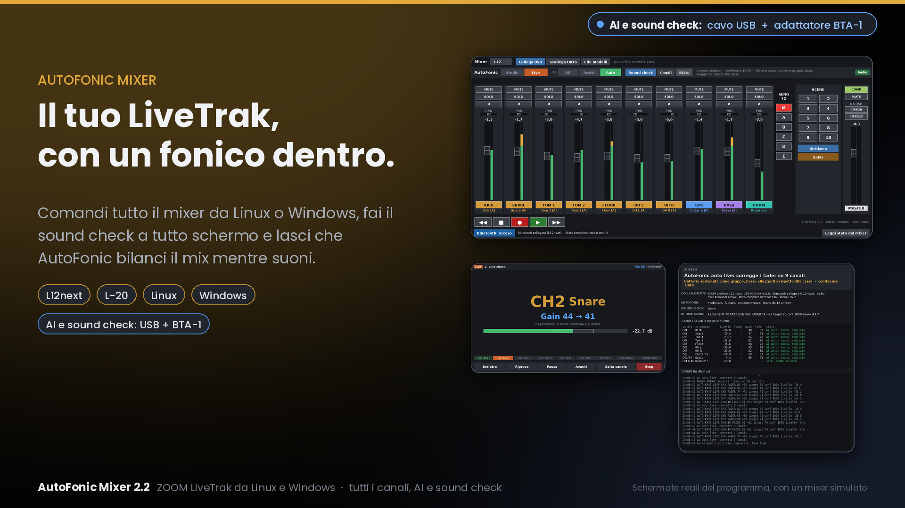
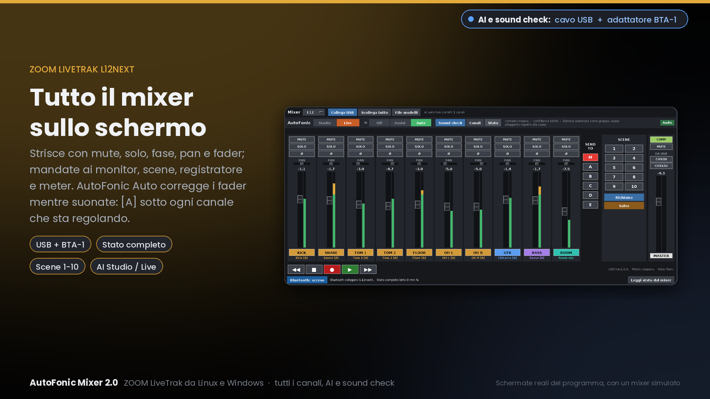
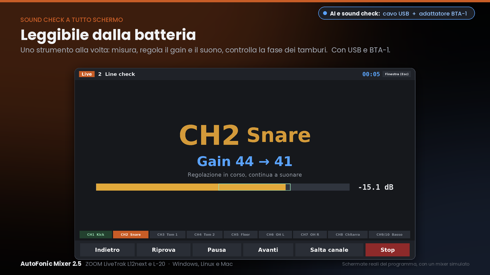
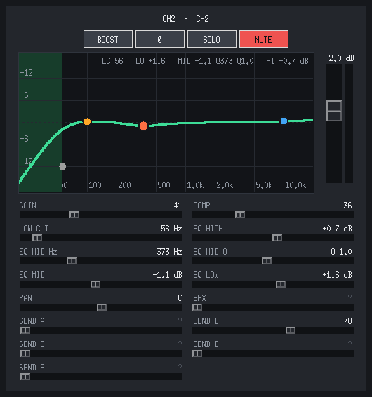
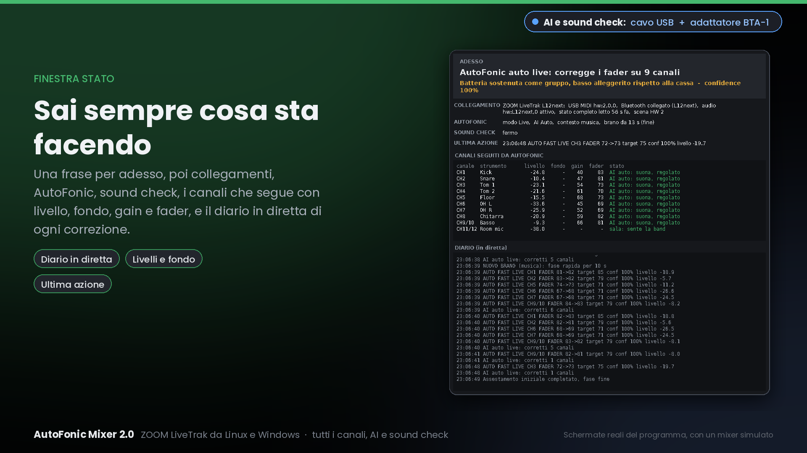
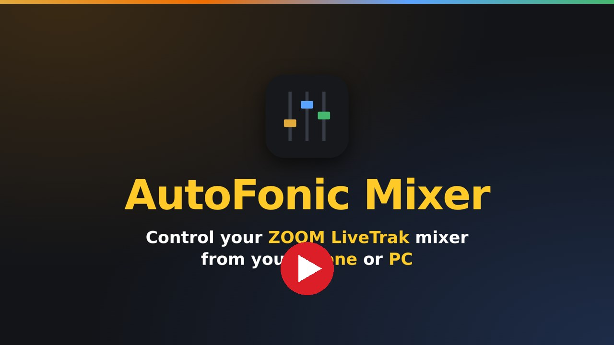

# 🎛️ AutoFonic Mixer

### Your ZOOM LiveTrak, with a sound engineer inside
**L12next · L-20 / L-20R · L6 / L6max** — from your **PC** (Windows, Linux, Mac) and your **Android phone**

*[Italiano più sotto](#italiano)*

AutoFonic Mixer controls your LiveTrak from your **computer** or **phone**, runs a **full-screen sound check**
(readable even from behind the drums) and **balances the mix while you play**, listening to the audio of
every channel.  In **10 languages**.

> 🙋 **Got an L-20 / L-20R or an L6?**  Tell me if it works with your mixer and get the **full version for free**.
> A short test guide: [L-20](PROVA_L20.md#english) · [L6](PROVA_L6.md#english) — or just write to **autofonic.mixer@gmail.com**
> what works and what doesn't.
> 💬 Feedback, problems, ideas: **[open an issue](https://github.com/francescorizzo-cyber/autofonic-mixer/issues/new/choose)** (free GitHub account) or email.

## 🎚️ Supported mixers

| Mixer | Connection | PC | Android |
|---|---|---|---|
| **L12next** | USB + ZOOM BTA-1 Bluetooth | ✅ everything, verified | ✅ verified |
| **L-20 / L-20R** | USB + ZOOM BTA-1 Bluetooth | 🟡 L-20, tested by Alan: faders and meters work, 2.8.13 fixes MUTE/SOLO and Read mixer state · L-20R: connects and reads the mixer | 🧪 being tested |
| **L6 / L6max** 🆕 | USB-C cable, or **wireless** with a CME WIDI Jack | 🟡 tested by one user | 🟡 tested by one user |

The L-8 cannot be controlled: it has neither MIDI nor the BTA-1.

> 🙋 **Got an L6 or an L-20?** Help me test it and get the **full version for free**:
> [L6 test](PROVA_L6.md#english) · [L-20 test](PROVA_L20.md#english) · write to **autofonic.mixer@gmail.com**

> 🧪 **Got a ZOOM R12 or R20 recorder?** There is a separate **tester app, only for R12 / R20 testers** (Android, listen only, it changes nothing on the recorder): [🧪 R12 / R20 tester app](https://github.com/francescorizzo-cyber/autofonic-mixer/releases/tag/tester-r12-r20)

## 💻 On the PC (Windows · Linux · Mac)

- **The whole mixer on screen**: faders, mute, solo, phase, pan, meters, monitor sends, scenes, recorder.
- **Channel page** 🆕: EQ curve, fader with meter, values in dB and Hz (click the channel name).
- **Full-screen sound check** in 4 phases: room silence, one instrument at a time (gain, sound, drum phase),
  the whole band (faders get balanced), saved to the scene you choose.
- **AI Studio / Live**: *Assist* suggests, *Auto* corrects the faders while you play, with the right rules for
  each instrument.  An optional room mic also listens to the room.
- **SD export**: the recordings on the SD card become WAV tracks named after the channel, plus the master and
  a stereo mix, in WAV or MP3.
- **Tuner** for guitar, bass and drums.
- **Respects your mixer**: never changes scene by itself, never touches monitor sends or master.

Sound check and AI need the **USB cable** (it carries every channel's audio) and, on L12next and L-20, the **BTA-1**.

| | |
|---|---|
|  |  |
|  |  |

## 📱 On Android

**[AutoFonic Mixer on Google Play](https://play.google.com/store/apps/details?id=com.autofonic.mixer)**: your phone becomes the mixer's remote control, right from the stage.

- Faders, mute, solo, pan, monitor sends, channel page with EQ and curve, scenes
- 🎤 **feedback finder** with the phone mic · 🎸 **tuner** · 💾 **saved setups**
- 🎧 **musician mode**: each player controls only their own monitor mix · 🔗 **stereo link** · 🔒 **touch lock**
- 7-day free trial, then a one-time purchase

## ▶️ Watch the video

## ⬇️ Download

From the **[Releases](../../releases/latest)**:

| System | File |
|---|---|
| Windows 10 / 11 | `AutoFonicMixer-DEMO-<version>-windows-x64-setup.exe` (install the ZOOM driver first) |
| Linux (Ubuntu / Debian) | `AutoFonicMixer-DEMO-<version>-linux-x86_64.tar.gz` (then `sh installa.sh`) |
| Mac (Apple Silicon) | `AutoFonicMixer-DEMO-<version>-mac-arm64.dmg` (first time: right click → Open) |
| Android | better from [Google Play](https://play.google.com/store/apps/details?id=com.autofonic.mixer), or `...-android.apk` |

**Full version**: free donation, even a small one, at **[paypal.me/AutoFonicMixer](https://paypal.me/AutoFonicMixer)**.
Then email **autofonic.mixer@gmail.com** the **code of your PC or phone** (**🔑 Unlock** button on the PC, tap
**DEMO** on Android): you get an unlock code, nothing to download.

## 🛠️ Custom features on request

Every band, venue or church works its own way: **mute groups**, **linked faders**, **partial control** (each
phone sees only what you choose), **safety limits** on faders and master, a **setlist** with one scene per
song, **automatic fades**, a **"break" button**, your own names, colours and layout.
Write to **autofonic.mixer@gmail.com** and tell me what you need.

<b>📖 Installation and tips</b>

**Windows**
1. Install your mixer's **ZOOM driver** (from the ZOOM website): it is needed for the audio of every channel.
2. Run the `...-windows-x64-setup.exe` file.  If SmartScreen warns you: *More info* → *Run anyway*.
3. Switch on the PC's Bluetooth (don't pair the BTA-1: the program finds it by itself) and plug in the USB cable.

**Linux**
1. Unpack the `.tar.gz`, run `sh installa.sh` in the folder, log out and back in.
2. Start "AutoFonic Mixer" from the menu: USB, audio and Bluetooth are found automatically.

**Mac**: open the `.dmg`, drag the app into Applications; the first time: right click → Open.  The Mac version
has not been tested with a real mixer yet: if you have a Mac and a LiveTrak, write to me.

**Android without Google Play**: download the `.apk` on the phone and allow the installation.  With L12next and
L-20, plug the BTA-1 in **before** switching the mixer on and close the ZOOM app (the BTA-1 accepts one
connection only).  With the L6: USB-C cable into the mixer's USB port, or a CME WIDI Jack in the MIDI socket.

**Mixer in another room**: Bluetooth has a short range.  Better: a small computer next to the mixer on the USB
cable, controlled from the other room with remote desktop over Wi-Fi.

## 🙏 Contributors

- **Leonardo Locaputo** and **Daniele Sabatelli**: they play in Francesco's band. Every new feature is tried
  with them first, in rehearsal and live, on the real L12next: it is thanks to them that AutoFonic can be tested
  with a real band before it reaches you. Thank you guys!
- **[haidelaidelo](https://github.com/haidelaidelo)** (Gabriele): first tests on a real **ZOOM LiveTrak L6**,
  USB audio channel order, MIDI controls, and lots of good ideas.
- **[alanpattle](https://github.com/alanpattle)** (Alan Pattle): the **ZOOM LiveTrak L-20** tester. Thank you Alan!
  He tests every new version on his real L-20, on the phone and on his Windows laptop, and sends detailed reports.
  His reports showed the L-20 meter layout, that the L-20 switches MUTE and SOLO with the value 1 (not 127),
  where names, faders and pan sit in the L-20 mixer state, and a missing file that stopped Bluetooth on Windows.
  Thanks to him, version 2.8.13 brings working meters, MUTE/SOLO and "Read mixer state" to the L-20.

---

# 🇮🇹 Italiano

### Il tuo ZOOM LiveTrak, con un fonico dentro
**L12next · L-20 / L-20R · L6 / L6max** — dal **PC** (Windows, Linux, Mac) e dal **telefono Android**

AutoFonic Mixer comanda il tuo LiveTrak dal **computer** o dal **telefono**, fa il **sound check a tutto
schermo** (leggibile anche da dietro la batteria) e **bilancia il mix mentre suoni**, ascoltando l'audio di
tutti i canali.  In **10 lingue**.

> 🙋 **Hai un L-20 / L-20R o un L6?**  Dimmi se funziona con il tuo mixer e ricevi **gratis la versione completa**.
> Una breve guida alla prova: [L-20](PROVA_L20.md) · [L6](PROVA_L6.md) — oppure scrivi semplicemente ad
> **autofonic.mixer@gmail.com** cosa funziona e cosa no.
> 💬 Commenti, problemi, idee: **[scrivi qui](https://github.com/francescorizzo-cyber/autofonic-mixer/issues/new/choose)** (account GitHub gratuito) oppure per email.

## 🎚️ Mixer supportati

| Mixer | Collegamento | PC | Android |
|---|---|---|---|
| **L12next** | USB + Bluetooth ZOOM BTA-1 | ✅ tutto, verificato | ✅ verificato |
| **L-20 / L-20R** | USB + Bluetooth ZOOM BTA-1 | 🟡 L-20, provato da Alan: fader e meter funzionano, la 2.8.13 corregge MUTE/SOLO e Leggi stato · L-20R: si collega e legge il mixer | 🧪 in prova |
| **L6 / L6max** 🆕 | cavo USB-C, oppure **senza fili** con un CME WIDI Jack | 🟡 provato da un utente | 🟡 provato da un utente |

Il L-8 non si può comandare: non ha né MIDI né BTA-1.

> 🙋 **Hai un L6 o un L-20?** Aiutami a provarlo e ricevi **gratis la versione completa**:
> [prova L6](PROVA_L6.md) · [prova L-20](PROVA_L20.md) · scrivi a **autofonic.mixer@gmail.com**

> 🧪 **Hai un registratore ZOOM R12 o R20?** C'è un'**app a parte, solo per i tester di R12 / R20** (Android, solo ascolto, non cambia niente sul registratore): [🧪 app tester R12 / R20](https://github.com/francescorizzo-cyber/autofonic-mixer/releases/tag/tester-r12-r20)

## 💻 Sul PC (Windows · Linux · Mac)

- **Tutto il mixer sullo schermo**: fader, mute, solo, fase, pan, meter, mandate ai monitor, scene, registratore.
- **Pagina del canale** 🆕: curva dell'EQ, fader con meter, valori in dB e Hz (clic sul nome del canale).
- **Sound check a tutto schermo** in 4 fasi: silenzio in sala, uno strumento alla volta (gain, suono, fase
  dei tamburi), tutta la band (i fader si bilanciano), salvataggio nella scena che scegli tu.
- **AI Studio / Live**: *Assist* propone, *Auto* corregge i fader mentre suonate, con le regole giuste per
  ogni strumento.  Un microfono ambientale, se vuoi, ascolta anche la sala.
- **Esporta SD**: le registrazioni della scheda SD diventano tracce WAV col nome del canale, il master e un
  mix stereo, in WAV o MP3.
- **Accordatore** per chitarra, basso e batteria.
- **Rispetta il tuo mixer**: non cambia mai scena da solo e non tocca monitor né master.

Per sound check e AI servono il **cavo USB** (porta l'audio di ogni canale) e, su L12next e L-20, il **BTA-1**.

## 📱 Su Android

**[AutoFonic Mixer su Google Play](https://play.google.com/store/apps/details?id=com.autofonic.mixer)**: il telefono diventa il telecomando del mixer, dal palco.

- Fader, mute, solo, pan, mandate ai monitor, pagina del canale con EQ e curva, scene
- 🎤 **caccia ai fischi** con il microfono del telefono · 🎸 **accordatore** · 💾 **setup salvati**
- 🎧 **modalità musicista**: ognuno regola solo la propria spia · 🔗 **canali uniti in stereo** · 🔒 **blocco dei tocchi**
- 7 giorni di prova completa, poi un solo acquisto

## ⬇️ Scarica

Dalle **[Release](../../releases/latest)**:

| Sistema | File |
|---|---|
| Windows 10 / 11 | `AutoFonicMixer-DEMO-<versione>-windows-x64-setup.exe` (prima installa il driver ZOOM) |
| Linux (Ubuntu / Debian) | `AutoFonicMixer-DEMO-<versione>-linux-x86_64.tar.gz` (poi `sh installa.sh`) |
| Mac (Apple Silicon) | `AutoFonicMixer-DEMO-<versione>-mac-arm64.dmg` (prima volta: tasto destro → Apri) |
| Android | meglio da [Google Play](https://play.google.com/store/apps/details?id=com.autofonic.mixer), oppure `...-android.apk` |

**Versione completa**: con un'offerta libera, anche minima, su **[paypal.me/AutoFonicMixer](https://paypal.me/AutoFonicMixer)**.
Poi scrivi a **autofonic.mixer@gmail.com** il **codice del tuo PC o telefono** (pulsante **🔑 Sblocca** sul PC,
tocca **DEMO** su Android): ricevi il codice di sblocco, senza scaricare niente.

## 🛠️ Personalizzazioni su richiesta

Ogni band, locale o chiesa lavora a modo suo: **mute di gruppo**, **fader collegati**, **controlli parziali**
(ogni telefono vede solo quello che decidi tu), **limiti di sicurezza** a fader e master, **scaletta** con una
scena per brano, **dissolvenze automatiche**, tasto **"pausa"**, nomi, colori e disposizione come piace a te.
Scrivi a **autofonic.mixer@gmail.com** e racconta cosa ti serve.

<b>📖 Installazione e consigli</b>

**Windows**
1. Installa il **driver ZOOM** del tuo mixer (dal sito ZOOM): serve per l'audio di tutti i canali.
2. Lancia il file `...-windows-x64-setup.exe`.  Se SmartScreen avvisa: *Ulteriori informazioni* → *Esegui comunque*.
3. Accendi il Bluetooth del PC (il BTA-1 non va abbinato: il programma lo trova da solo) e attacca il cavo USB.

**Linux**
1. Scompatta il `.tar.gz`, nella cartella esegui `sh installa.sh`, esci dalla sessione e rientra.
2. Avvia "AutoFonic Mixer" dal menu: USB, audio e Bluetooth si trovano da soli.

**Mac**: apri il `.dmg`, trascina l'app in Applicazioni, la prima volta: tasto destro → Apri.  La versione
per Mac non è ancora stata provata con un mixer vero: se hai un Mac e un LiveTrak, scrivimi.

**Android senza Google Play**: scarica l'`.apk` dal telefono e consenti l'installazione.  Con L12next e
L-20 inserisci il BTA-1 **prima** di accendere il mixer e chiudi l'app ZOOM (il BTA-1 accetta un solo
collegamento).  Con il L6: cavo USB-C nella presa USB del mixer, oppure un CME WIDI Jack nella presa MIDI.

**Mixer in un'altra stanza**: il Bluetooth ha poca portata.  Meglio un piccolo computer accanto al mixer,
sul cavo USB, comandato dall'altra stanza con il desktop remoto via Wi-Fi.

## 🙏 Chi ha contribuito

- **Leonardo Locaputo** e **Daniele Sabatelli**: suonano con Francesco. Ogni nuova funzione si prova prima con
  loro, alle prove e dal vivo, sul L12next vero: è grazie a loro che AutoFonic viene provato con una band vera
  prima di arrivare a voi. Grazie ragazzi!
- **[haidelaidelo](https://github.com/haidelaidelo)** (Gabriele): le prime prove su un **ZOOM LiveTrak L6** vero,
  l'ordine dei canali audio USB, i comandi MIDI e tante buone idee.
- **[alanpattle](https://github.com/alanpattle)** (Alan Pattle): il tester del **ZOOM LiveTrak L-20**. Grazie Alan!
  Prova ogni nuova versione sul suo L-20 vero, dal telefono e dal portatile Windows, e manda rapporti dettagliati.
  I suoi rapporti hanno fatto scoprire com'è fatto il pacchetto dei meter del L-20, che il L-20 accende MUTE e SOLO
  con il valore 1 (non 127), dove stanno nomi, fader e pan nello stato del mixer e un file mancante che bloccava il
  Bluetooth su Windows.  Grazie a lui la 2.8.13 porta sull'L-20 meter, MUTE/SOLO e "Leggi stato dal mixer".

---

Independent project, not affiliated with, sponsored or endorsed by ZOOM Corporation.  ZOOM, LiveTrak,
L12next, L-20, L6 and BTA-1 are trademarks of ZOOM Corporation.  Provided without warranty: try it at low volume
before using it live.  · Progetto indipendente, non affiliato a ZOOM Corporation.  License: [LICENSE](LICENSE).
