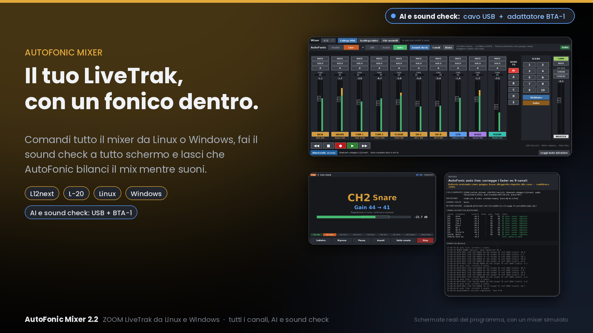
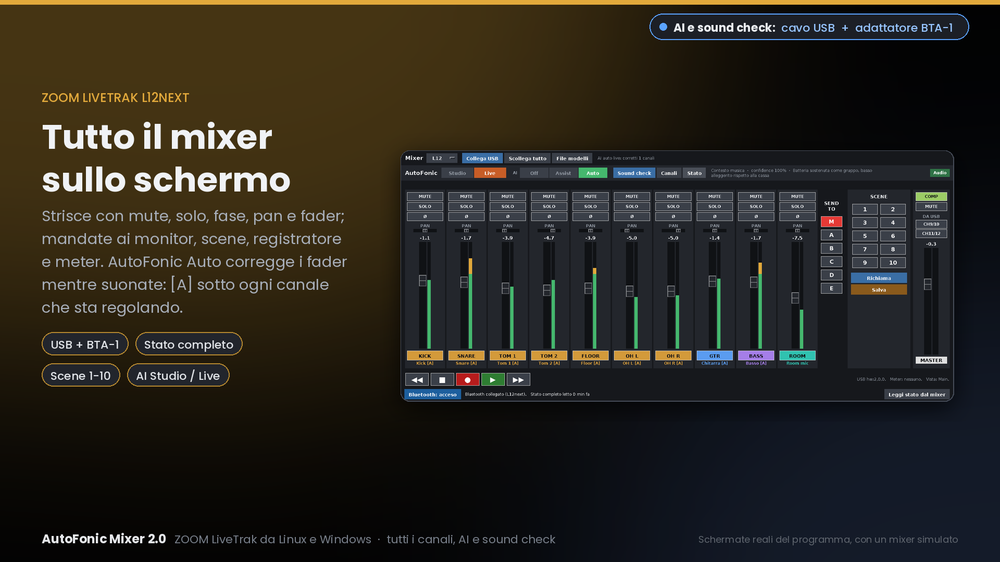
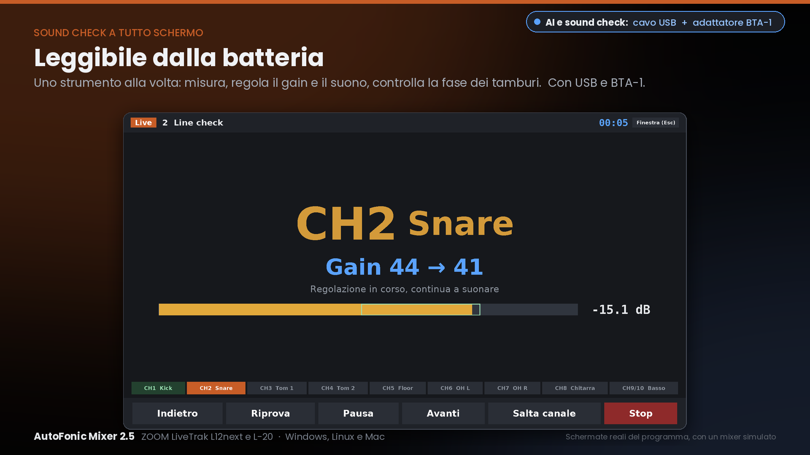
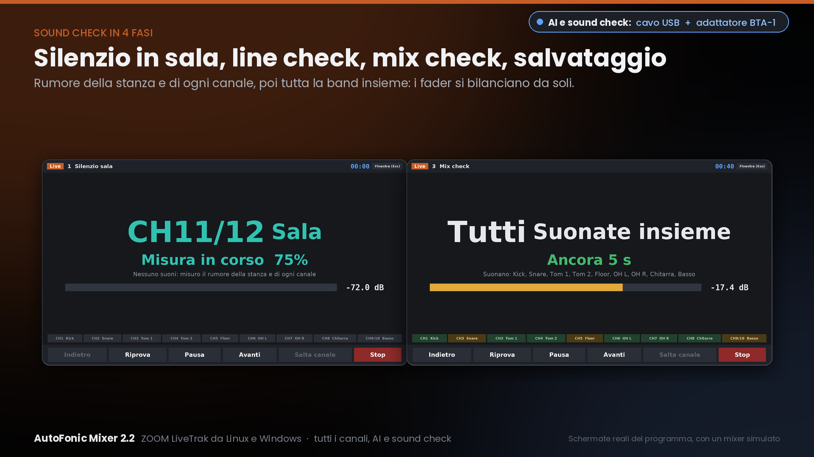
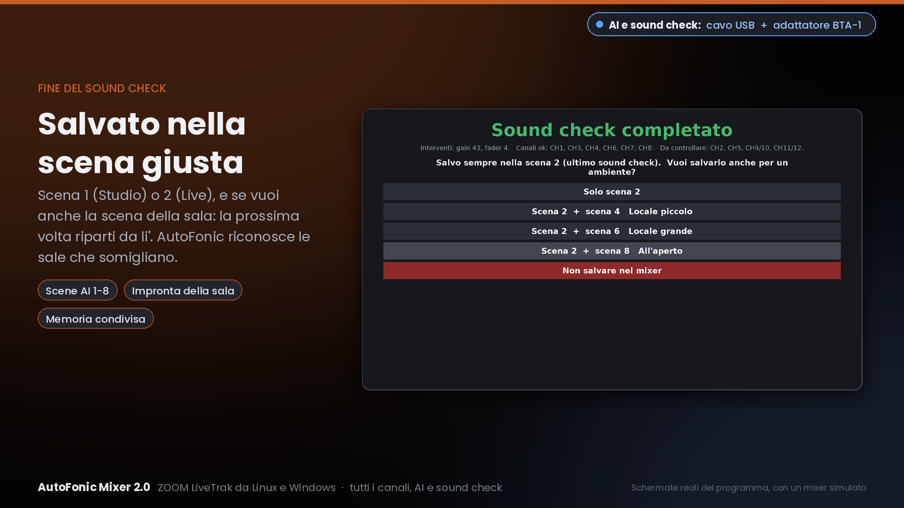
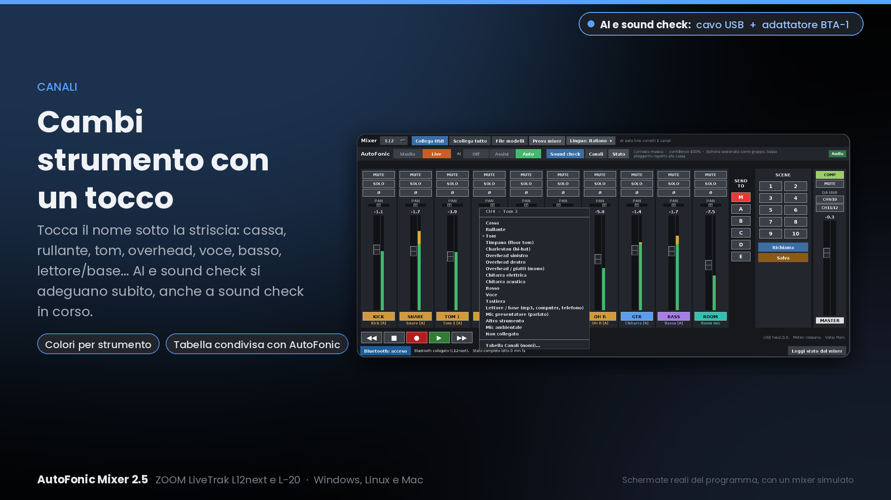
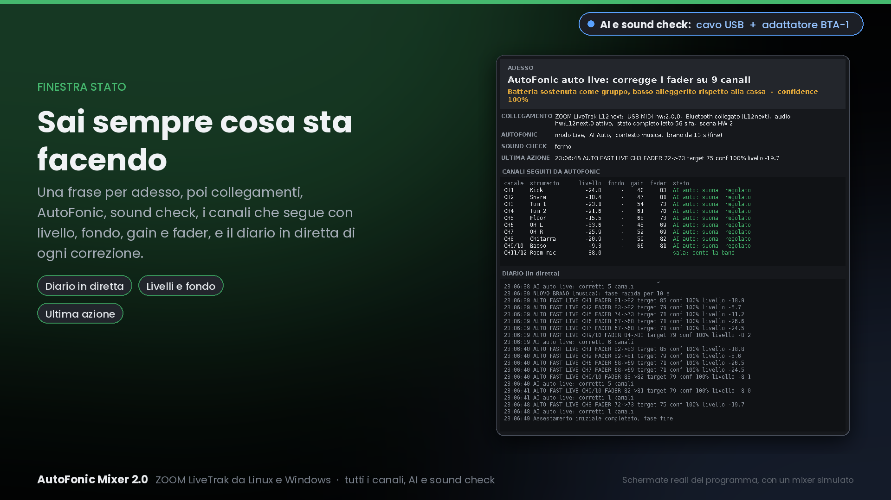
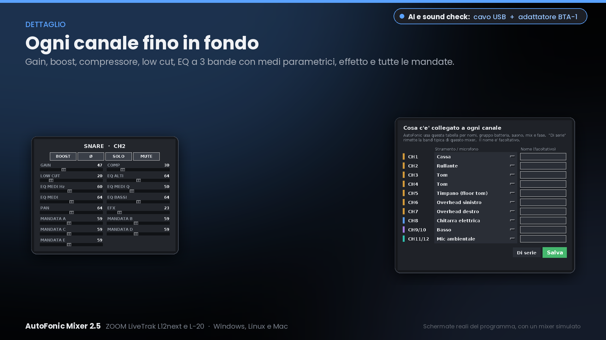
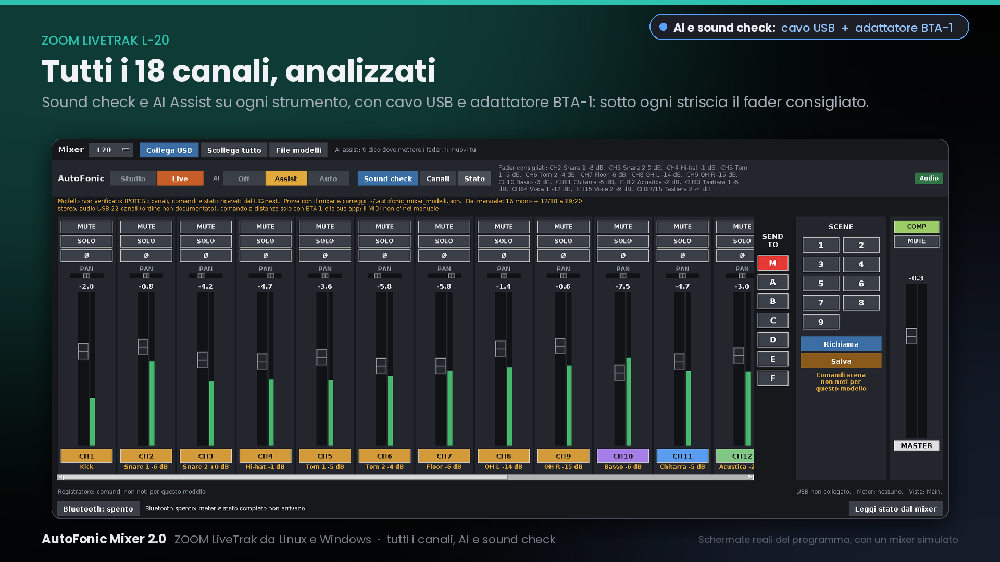

# AutoFonic Mixer per ZOOM LiveTrak L12next e L-20

*[English below](#english)*

**Il tuo LiveTrak, con un fonico dentro.**  AutoFonic Mixer comanda il mixer da **Linux o Windows**, e ora
anche dal **telefono o tablet Android**, in **10 lingue** (italiano, inglese, francese, spagnolo, tedesco, portoghese, svedese, danese, sloveno,
croato), fa il sound check a tutto schermo e bilancia il mix mentre suoni, analizzando l'audio di **tutti i canali**.

> **Per AI e sound check servono tutti e due: il cavo USB e l'adattatore Bluetooth ZOOM BTA-1.**
> Il cavo USB porta l'audio di ogni canale e i comandi; il BTA-1 porta lo stato completo del mixer (gain e
> fader veri).

## Cosa fa

- **Tutto il mixer sullo schermo**: strisce con mute, solo, fase, pan, fader e meter; mandate ai monitor,
  scene, registratore, master.  Canale completo: gain, boost, compressore, low cut, EQ a 3 bande con medi
  parametrici, effetto e tutte le mandate.
- **Sound check a tutto schermo**, leggibile dalla batteria, in 4 fasi: silenzio in sala, line check (uno
  strumento alla volta: gain, suono, fase dei tamburi), mix check (tutta la band: i fader si bilanciano),
  salvataggio nella scena del mixer.
- **AI Studio / Live**: *Assist* propone, *Auto* corregge i fader da sola mentre suonate, con i pesi giusti
  per ogni strumento e le regole musicali (cassa e basso, coppia di overhead, batteria come gruppo).
- **Tutti i canali**: 10 sul L12next, 18 sul L-20.  Un mic ambientale, su qualsiasi canale, ascolta la sala.
- **Strumenti al volo**: tocca il nome sotto una striscia e scegli cassa, rullante, tom, overhead, voce,
  basso, tastiera, lettore/base (mp3, computer, telefono)...  AI e sound check si adeguano subito.
- **Rispetta il tuo mixer**: non cambia mai scena da solo, non tocca monitor ne' master; a fine sound check
  scegli tu in quale scena salvare.
- **Si vede dal banco**: quando si collega, i MUTE del L12next si accendono in sequenza e tornano com'erano
  (solo in silenzio, mai mentre suonate).
- **Esporta SD** (nuovo nella 2.6): le registrazioni della scheda SD del mixer diventano tracce WAV col nome
  del canale ("03 Tom.wav"), il master in WAV o MP3 e un mix stereo dalle tracce, in WAV o MP3.
- **Accordatore** (nuovo nella 2.6): chitarra e basso (accordatura standard, Drop D, mezzo tono sotto...) e
  batteria passo passo: tiranti uguali sulla battente e sulla risonante, poi la nota di ogni tamburo per lo
  stile che scegli (jazz, medio, rock).
- **App per Android** (nuova nella 2.7): telefono e tablet, via Bluetooth (BTA-1).  Fader, mute, solo, pan,
  mandate ai monitor, pagina del canale con gain, compressore, EQ a 3 bande (con la curva), low cut ed effetto,
  scene del L12next, strumenti e nomi per ogni canale, 10 lingue.
- **Finestra Stato**: cosa sta facendo il programma adesso, i canali con livello, gain e fader, e il diario
  in diretta di ogni correzione.

| | |
|---|---|
|  |  |
|  |  |
|  |  |
|  |  |

*Le immagini sono schermate reali del programma, prese con un mixer simulato.*

## Mixer supportati

| Mixer | Comandi | AI | Sound check |
|---|---|---|---|
| ZOOM LiveTrak **L12next** | USB + Bluetooth (BTA-1), verificati | Assist e Auto | completo (gain automatico) |
| ZOOM LiveTrak **L-20** | in prova | Assist (posizione consigliata dei fader) | a consigli (giri tu il gain) |

L6 e L-8 non sono supportati: non hanno il BTA-1.

**Hai un L-20?** Aiutami a verificarlo su Windows o Linux: segui la **[procedura di prova per il
L-20](PROVA_L20.md)** (mezz'ora, il programma ti guida) e mandami per email il file che prepara.

## DEMO e versione completa

Qui trovi la **DEMO gratuita** (nelle [Release](../../releases)).

| | DEMO | Completa |
|---|---|---|
| Programma per PC | **tutto come la completa per 14 giorni**, poi non comanda più il mixer | sempre |
| Esporta SD (PC) | tutto per 7 giorni, poi solo tracce WAV | tutto (tracce, master, mix, MP3) |
| Accordatore (PC) | 7 giorni | sempre |
| App Android | **tutto per 7 giorni**, poi non comanda più il mixer | sempre |

**Versione completa: con un'offerta libera, anche minima, per sostenere il progetto.**
1. Fai l'offerta su **[paypal.me/AutoFonicMixer](https://paypal.me/AutoFonicMixer)**.
2. Scrivi a **autofonic.mixer@gmail.com** il **codice del tuo PC o telefono** (8 caratteri): nella DEMO lo
   trovi con il pulsante **🔑 Sblocca** (PC) o toccando **DEMO** (Android).
3. Ricevi il **codice di sblocco** (12 caratteri): inseriscilo nello stesso punto e la DEMO diventa la
   versione **completa**, senza scaricare niente.  Il codice vale per quel PC o quel telefono.

## Download

Nelle [Release](../../releases) trovi la DEMO per Windows, Linux e Android (e l'ultima per Mac):

| Sistema | File |
|---|---|
| Windows 10 / 11 (64 bit) | `AutoFonicMixer-DEMO-<versione>-windows-x64-setup.exe` |
| Linux (Ubuntu / Debian, 64 bit) | `AutoFonicMixer-DEMO-<versione>-linux-x86_64.tar.gz` |
| Android 8 o più recente (telefono, tablet) | `AutoFonicMixer-DEMO-<versione>-android.apk` |
| Mac (Apple Silicon) - **ultima versione 2.7.0, niente più aggiornamenti** | `AutoFonicMixer-DEMO-2.7.0-mac-arm64.dmg` (prima volta: tasto destro → Apri) |

> **Mac**: la versione per Mac si ferma alla **2.7.0**.  Resta scaricabile e funziona (anche con il codice di
> sblocco), ma non riceve più aggiornamenti né nuove funzioni.  Non è mai stata provata con un mixer vero.

## Installazione su Windows

1. Installa il **driver ZOOM** del tuo mixer (dal sito ZOOM): serve per l'audio di tutti i canali (ASIO).
2. Lancia `AutoFonicMixer-DEMO-...-windows-x64-setup.exe` (non servono i permessi di amministratore).
   Se SmartScreen avvisa "app non riconosciuta": *Ulteriori informazioni* → *Esegui comunque*.
3. Avvia **AutoFonic Mixer** dal menu Start.
4. Accendi il Bluetooth del PC.  Il BTA-1 **non** va abbinato nelle impostazioni di Windows: il programma lo
   trova da solo.  Attacca il cavo USB: anche quello viene trovato da solo.

## Installazione su Linux (Ubuntu / Debian, PC 64 bit)

1. Scarica dalle [Release](../../releases) il file `AutoFonicMixer-DEMO-...-linux-x86_64.tar.gz` e scompattalo.
2. Nella cartella: `sh installa.sh` (installa gli strumenti ALSA e Bluetooth, i permessi e l'icona nel menu).
3. Esci dalla sessione e rientra.
4. Avvia: `autofonic-mixer` (oppure `autofonic-mixer L20`), o dal menu "AutoFonic Mixer".
5. Accendi il mixer, attacca il cavo USB e il BTA-1: il programma li trova **da solo** (USB, audio e Bluetooth) e si ricollega se il cavo si stacca.

## Installazione su Android

1. Dal telefono apri la pagina delle [Release](../../releases) e scarica `AutoFonicMixer-DEMO-...-android.apk`.
2. Aprilo: Android chiede di **consentire l'installazione** da questa fonte (browser o file): consenti e
   installa.
3. Inserisci il **BTA-1** nel mixer **prima di accenderlo**, chiudi l'app ZOOM (il BTA-1 accetta un solo
   collegamento) e apri **AutoFonic Mixer**: consenti "Dispositivi nelle vicinanze" e il collegamento parte da
   solo.
4. Tocca il **nome in cima a una striscia** per la pagina del canale (gain, comp, EQ...), **Canali** per gli
   strumenti, **🎬 Scene** per le scene, **🌐** per la lingua.

Il L-20 sull'app Android è **in prova**: se qualcosa non va, premi **Rapporto** e mandamelo.

## Comandare il mixer da un'altra stanza

Studio insonorizzato e regia in un'altra stanza?
- **Bluetooth (BTA-1)**: ha poca portata e un muro insonorizzato lo blocca quasi del tutto.  Si può provare un
  adattatore Bluetooth USB su una prolunga corta, il più vicino possibile alla sala.  Dà solo i comandi
  (fader, mute, scene), non l'audio dei canali.
- **Soluzione migliore**: un piccolo computer accanto al mixer (un vecchio portatile o un mini PC), collegato con
  il cavo USB e con AutoFonic Mixer acceso.  Dall'altra stanza lo comandi via **Wi-Fi con il desktop remoto**
  (Desktop remoto di Windows, Chrome Remote Desktop, AnyDesk...): hai tutto, senza cavi tra le stanze.
- Per **ascoltare** dalla regia serve comunque un collegamento audio: cuffie senza fili su un'uscita monitor,
  oppure un programma di ascolto a distanza sullo stesso computer.

## Avvertenze

Progetto indipendente, **non affiliato, sponsorizzato o approvato da ZOOM Corporation**.  ZOOM, LiveTrak,
L12next, L-20 e BTA-1 sono marchi di ZOOM Corporation.  Il programma e' fornito senza garanzia: provalo a
volume basso prima di usarlo dal vivo.  Licenza: vedi [LICENSE](LICENSE).

---

## English

**Your LiveTrak, with a sound engineer inside.**  AutoFonic Mixer controls the ZOOM LiveTrak **L12next** and
**L-20** from **Linux or Windows**, and now also from an **Android phone or tablet**, runs a full-screen sound check and balances the mix while you play,
analysing the audio of **every channel**.  The program is in **10 languages**: English, Italian, French, Spanish, German, Portuguese, Swedish, Danish,
Slovenian and Croatian (menu "Language").

> **AI and sound check need both the USB cable and the ZOOM BTA-1 Bluetooth adapter.**

- **The whole mixer on screen**: strips, sends, scenes, recorder, master; full channel with gain, comp, EQ.
- **Full-screen sound check** in 4 phases: room silence, line check (gain, sound, drum phase), mix check,
  save to the scene you choose.
- **AI Studio / Live**: *Assist* suggests fader positions, *Auto* corrects them while you play.
- **Respects your mixer**: never changes scene by itself, never touches monitor sends or master.
- **Instruments on the fly**, including a **player / backing track** (mp3, computer, phone).
- **SD export** (new in 2.6): the recordings on the mixer's SD card as WAV tracks named after the channel,
  the master as WAV or MP3 and a stereo mix of the tracks.
- **Tuner** (new in 2.6): guitar, bass and drums (lugs even on both heads, then the note of each drum).
- **Android app** (new in 2.7): phone and tablet over Bluetooth (BTA-1): faders, mute, solo, pan, monitor
  sends, channel page with gain, comp, 3-band EQ (with its curve), low cut and effect, L12next scenes,
  instruments and names for each channel, 10 languages.
- **Test mixer**: guided tests and a report to send when something does not work.

| Mixer | Commands | AI | Sound check |
|---|---|---|---|
| ZOOM LiveTrak **L12next** | USB + Bluetooth (BTA-1), verified | Assist and Auto | full (automatic gain) |
| ZOOM LiveTrak **L-20** | being tested | Assist (recommended faders) | advice (you turn the gain) |

**Do you have an L-20?** Help me test it on Windows or Linux: follow the **[L-20 test procedure](PROVA_L20.md#english)**.

**Download** the free **DEMO** from the [Releases](../../releases): Windows 10/11 (`...-windows-x64-setup.exe`,
install the ZOOM driver first), Linux (`...-linux-x86_64.tar.gz`, then `sh installa.sh`), Mac Apple Silicon (`AutoFonicMixer-DEMO-2.7.0-mac-arm64.dmg`: **last Mac version, no further updates**), Android 8 or newer (`...-android.apk`: download it on the phone, allow the
installation, plug the BTA-1 in before switching the desk on, close the ZOOM app).  The PC DEMO works **fully
for 14 days**, the Android DEMO for **7 days**; after that they no longer control the mixer.  SD export and tuner
(PC): 7 days.

**Full version: with a free donation, even a small one, to support the project.**  Donate at
**[paypal.me/AutoFonicMixer](https://paypal.me/AutoFonicMixer)**, then write to **autofonic.mixer@gmail.com**
with the **code of your PC or phone** (8 characters: **🔑 Unlock** button on the PC, tap **DEMO** on Android).
You receive an **unlock code** (12 characters): enter it in the same place and the DEMO becomes the **full
version**, nothing to download.  The code works for that PC or phone.

**Controlling the desk from another room** (soundproofed studio): the BTA-1 Bluetooth has a short range and
soundproofing blocks it.  Best option: a small computer next to the desk on the USB cable, running AutoFonic
Mixer, controlled from the other room over **Wi-Fi with remote desktop** (Windows Remote Desktop, Chrome Remote
Desktop, AnyDesk...).  To listen you still need an audio link (e.g. wireless headphones on a monitor out).

Independent project, not affiliated with ZOOM Corporation.  ZOOM, LiveTrak, L12next, L-20 and BTA-1 are
trademarks of ZOOM Corporation.  License: see [LICENSE](LICENSE).
