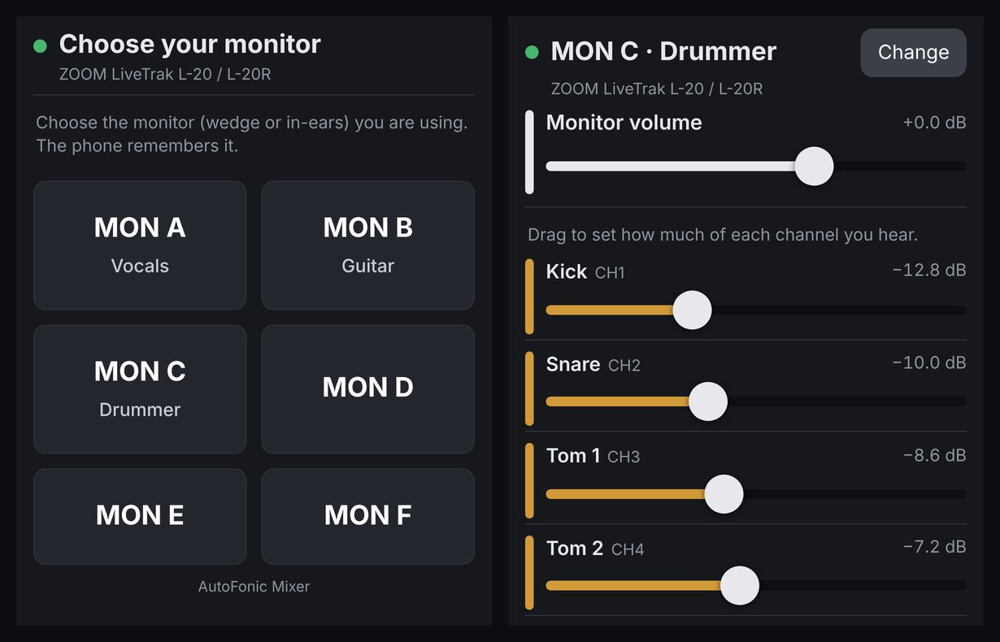
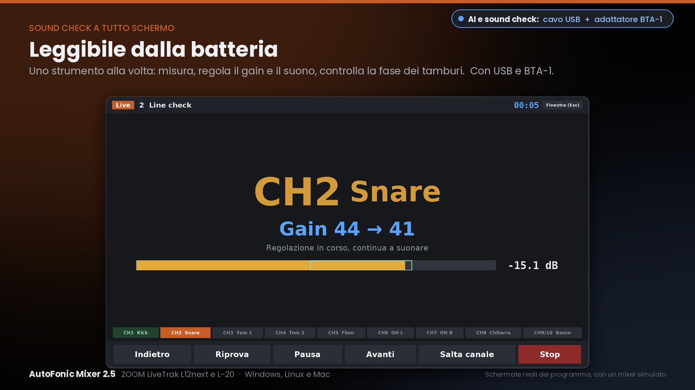
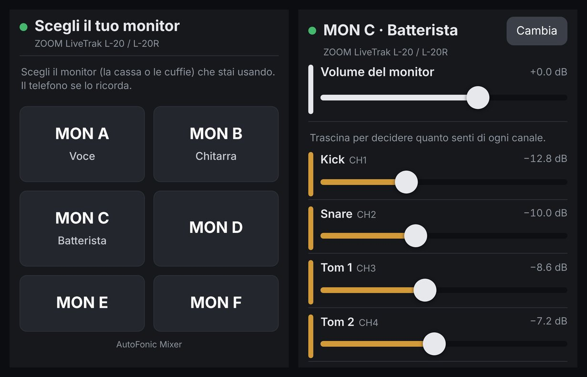

# 🎛️ AutoFonic Mixer

### Your ZOOM LiveTrak, with a sound engineer inside
**ZOOM** L12next · L-20 / L-20R · L6 / L6max — **Behringer / Midas** XR12 · XR16 · XR18 / MR18 · X32 / M32 
from your **PC** (Windows, Linux, Mac) and your **Android phone**

*[Italiano più sotto](#italiano)*

AutoFonic Mixer controls your LiveTrak from your **computer** or **phone**, runs a **full-screen sound check**
(readable even from behind the drums) and **balances the mix while you play**, listening to the audio of
every channel.  In **10 languages**.

🌐 **Website:** https://francescorizzo-cyber.github.io/autofonic-mixer/

## 🆕 News

- **2.9.5** · 21 Nov 2026 — 🎙 **Virtual soundcheck** (L-20, PC and phone): Record really starts the recorder and **Back to live puts every REC/PLAY key back exactly as it was** · 📱 Monitors from the phone: scrolling no longer moves the faders; on Android 17 Chrome / Edge need the Nearby devices permission · 🐧 Linux: no more sudden closing with Monitors from the phone
- **2.9.4** · 20 Nov 2026 — 🎚 L-20 / L-20R on the PC: the **FX1 RTN and FX2 RTN** strips no longer disappear when an older models file is present
- **2.9.3** · 20 Nov 2026 — 🎚 sound check: **Pause and Stop no longer save into scene 1 or 2 by themselves**
  (Stop asks where to save) · 🎛 safer gain in Live · 💾 Behringer XR: the scene is saved at the end of the sound check ·
  🤖 L-20: AI Assist keeps working after the sound check · 🅿️ **PayPal** button in the PC Unlock window
- **2.9.2** · 20 Nov 2026 — 📱 **Monitors from the phone**: each musician sets their own monitor mix from the phone
  or tablet browser (iPhone and iPad too), with AutoFonic Mixer on the PC holding the mixer ·
  🎚 **Virtual soundcheck** for L-20 / L-20R (PC and Android) · 🎨 default instruments for Behringer and L6
- **2.9.1** · 19 Nov 2026 — 🔓 the PC program **unlocks by itself** after paying by card · 💾 L-20: **SD
  recording time left** · 🎬 scene buttons with just the number
- **2.9** · 18 Nov 2026 — 🎛️ **Behringer and Midas** mixers on the PC: X Air XR12 · XR16 · XR18, X32, Midas MR18 ·
  M32 · 💳 full PC version €9.99, unlock code right after paying · 🪕 ukulele instruments

Full release notes: **[all versions](../../releases)**.

**The ZOOM LiveTrak app for Android and PC.**  ZOOM's own control apps (L-20 Control, L-12 Control) run only on
iPhone and iPad: AutoFonic Mixer is the **ZOOM L-20 / L-20R app for Android**, the **L12next remote control for
Android**, and a **LiveTrak controller for Windows, Linux and Mac**.  Get it on
**[Google Play](https://play.google.com/store/apps/details?id=com.autofonic.mixer)**.

## ⬇️ Download — free demo

Tap the button for your system: the download of the **latest version** starts right away.

| System | Download | Notes |
|---|---|---|
| 🤖 **Android** 8+ |  | 7-day full trial, then a one-time purchase |
| 🪟 **Windows** 10 / 11 |  | install the **ZOOM driver** of your mixer first |
| 🐧 **Linux** (Ubuntu / Debian) |  | unpack, then `sh installa.sh` |
| 🍎 **Mac** (Apple Silicon) |  | first time: right click → Open |

Release notes and older versions: **[all releases](../../releases)**.  Full PC version: see [below](#full-version).

## 🎚️ Supported mixers

| Mixer | Connection | PC | Android |
|---|---|---|---|
| **L12next** | USB + ZOOM BTA-1 Bluetooth | ✅ works | ✅ works |
| **L-20 / L-20R** | USB + ZOOM BTA-1 Bluetooth | ✅ works — all controls | ✅ works — all controls |
| **L6 / L6max** | USB-C cable, or **wireless** with a CME WIDI Jack | ✅ works | ✅ works |
| **Behringer X Air XR18** · Midas MR18 | network: Wi-Fi or Ethernet cable | ✅ works — with sound check and AI (USB audio) | — |
| **Behringer X Air XR12 · XR16** · Midas MR12 | network: Wi-Fi or Ethernet cable | ✅ works — with level and gain check | — |
| **Behringer X32** · Midas M32 | network: Ethernet cable | ✅ works — 32 channels, sound check and AI with the X-USB card | — |

**All controls** means faders, pan, mute, solo, EQ, low cut, sends, stereo channels, effect returns, scenes,
recorder (with its time) and meters — every one tried by users on their own mixer
(L-20: [Alan](#-contributors) · L6: [Gabriele](#-contributors)).  The L-8 cannot be controlled: it has neither
MIDI nor the BTA-1.

**Behringer / Midas**: faders, mute, solo, pan, gain, phase, low cut, EQ, compressor, gate, sends to the buses
and the effects, mute groups, scenes / snapshots and meters.  The mixer is found on the network by itself, and the
channel names written on the mixer become the instruments of the sound check.

> 💬 Feedback, problems, ideas: **[open an issue](https://github.com/francescorizzo-cyber/autofonic-mixer/issues/new/choose)** (free GitHub account) or write to **autofonic.mixer@gmail.com**.

## 🎚 Virtual soundcheck — ZOOM L-20 / L-20R — new in 2.9.2

**Soundcheck without the band.**  Record the band once on the mixer's SD card, then play the tracks back through
their own channels and set up the mix in peace: EQ, faders, monitor sends, even the AI sound check — the day
before the gig or with the venue still empty.

- **One button for everything**: AutoFonic Mixer arms the channels, records, rewinds and plays, in **loop**: when
  the recording ends it starts again
- the recorded tracks of **CH1–16** come back into their channels, exactly as the mixer's REC/PLAY keys do
- **"Back to live"** puts every channel back as it was, also if you close the program, the Bluetooth drops or the
  demo ends: no channel stays without its input at the gig
- **PC and Android**, **in the free demo too**

Only for the **ZOOM LiveTrak L-20 and L-20R**: they are the only LiveTrak mixers whose tracks can be switched to
PLAY one by one from an app.  First version: your reports from real gigs are welcome.

## 📱 Monitors from the phone — new in 2.9.2

**Every musician sets their own monitor mix, from their own phone.**  AutoFonic Mixer on the PC holds the mixer;
the musicians scan a QR code and a page opens in the browser: **iPhone, iPad and Android, nothing to install**.

- each one picks their monitor (name them on the PC, e.g. *C · Drummer*) and moves only **their own** mix: how much
  of each channel they hear, plus the monitor volume
- **several phones at once**; what the sound engineer changes shows up on the phones by itself
- **safe**: a 4-digit code, only the monitor sends (never the main mix, mutes or scenes), only from the local network
- ZOOM L12next, L-20 / L-20R, L6 and Behringer X Air / X32.  On the PC: **☰ More → 📱 Monitors from the phone**
- free during the 14-day PC demo

**Connecting the phones:** PC and phones on the same Wi-Fi, no internet needed.  The safest is any Wi-Fi router on
stage; the venue's Wi-Fi works too (not the "guest" network), or a phone's or the PC's hotspot.  If Windows asks
for network access, answer *Allow*; if it works at home but not at the venue, set that Wi-Fi as a *private* network.

## 💻 On the PC (Windows · Linux · Mac)

- **The whole mixer on screen**: faders, mute, solo, phase, pan, meters, monitor sends, scenes, recorder.
- **Channel page** 🆕: EQ curve, fader with meter, values in dB and Hz (click the channel name).
- **Full-screen sound check** in 4 phases: room silence, one instrument at a time (gain, sound, drum phase),
  the whole band (faders get balanced), saved to the scene you choose.
- **AI Studio / Live**: *Assist* suggests, *Auto* corrects the faders while you play, with the right rules for
  each instrument.  An optional room mic also listens to the room.
- **SD export**: the recordings on the SD card become WAV tracks named after the channel, plus the master and
  a stereo mix, in WAV or MP3.
- **Tuner** for guitar, bass and drums.
- **Respects your mixer**: never changes scene by itself, and the AI never touches monitor sends or master.

Sound check and AI need the **USB cable** (it carries every channel's audio) and, on L12next and L-20, the **BTA-1**.

| | |
|---|---|
|  |  |
|  |  |

## 📱 On Android

**[AutoFonic Mixer on Google Play](https://play.google.com/store/apps/details?id=com.autofonic.mixer)**: your phone becomes the mixer's remote control, right from the stage.

- Faders, mute, solo, pan, monitor sends, channel page with EQ and curve, scenes
- 🎤 **feedback finder** with the phone mic · 🎸 **tuner** · 💾 **saved setups**
- 🎧 **musician mode**: each player controls only their own monitor mix · 🔗 **stereo link** · 🔒 **touch lock**
- 7-day free trial, then a one-time purchase

## ▶️ Watch the video

## 🔑 Full PC version

The PC download is a **free demo**: everything works for 14 days.  **Full version: €9.99, one time only**, valid forever on
that PC.

**⚡ Pay by card and you get the unlock code right away**, on screen and by email: no waiting.

You need the **code of your PC** (**🔑 Unlock** button in the program), then choose how to pay:

- **[💳 Card, Google Pay or Apple Pay](https://buy.stripe.com/fZu8wO1DR85S9pugiB63K00)** (Stripe): write the code of your PC when paying — **⚡ the unlock code
  appears right after paying** and arrives by email too.
- **[🅿️ PayPal](https://paypal.me/AutoFonicMixer/9.99EUR)**: then email **autofonic.mixer@gmail.com** the code of your PC — you get the unlock code by email.

Nothing to download.  On Android: from Google Play the full version is bought inside the app.

## 🛠️ Custom features on request

Every band, venue or church works its own way: **mute groups**, **linked faders**, **partial control** (each
phone sees only what you choose), **safety limits** on faders and master, a **setlist** with one scene per
song, **automatic fades**, a **"break" button**, your own names, colours and layout.
Write to **autofonic.mixer@gmail.com** and tell me what you need.

<b>📖 Installation and tips</b>

**Windows**
1. Install your mixer's **ZOOM driver** (from the ZOOM website): it is needed for the audio of every channel.
2. Run the downloaded `AutoFonicMixer-DEMO-windows-x64-setup.exe` file.  If SmartScreen warns you: *More info* → *Run anyway*.
3. Switch on the PC's Bluetooth (don't pair the BTA-1: the program finds it by itself) and plug in the USB cable.

**Linux**
1. Unpack the `.tar.gz`, run `sh installa.sh` in the folder, log out and back in.
2. Start "AutoFonic Mixer" from the menu: USB, audio and Bluetooth are found automatically.

**Mac**: open the `.dmg`, drag the app into Applications; the first time: right click → Open.  The Mac version
has been tried with an L-20R over Bluetooth and USB.

**Android**: install AutoFonic Mixer from [Google Play](https://play.google.com/store/apps/details?id=com.autofonic.mixer).  With L12next and
L-20, plug the BTA-1 in **before** switching the mixer on and close the ZOOM app (the BTA-1 accepts one
connection only).  With the L6: USB-C cable into the mixer's USB port, or a CME WIDI Jack in the MIDI socket.

**Mixer in another room**: Bluetooth has a short range.  Better: a small computer next to the mixer on the USB
cable, controlled from the other room with remote desktop over Wi-Fi.

## ❓ FAQ

**Is there a ZOOM L-20 / L-20R app for Android?**  Yes: AutoFonic Mixer, on [Google Play](https://play.google.com/store/apps/details?id=com.autofonic.mixer).
ZOOM's L-20 Control app exists only for iOS.  It connects with the ZOOM BTA-1 Bluetooth adapter, like ZOOM's app.

**Can I control a ZOOM LiveTrak L-20R without an iPad?**  Yes, from an Android phone or from a Windows, Linux or
Mac computer: faders, mute, solo, pan, EQ, monitor mixes A–F, effect returns, scenes and the SD recorder.

**Is there an app for the ZOOM L12next / L-12 on Android or Windows?**  Yes, AutoFonic Mixer supports the L12next
on Android and on the PC, where it also does the sound check and the automatic mix.  The original L-12 is not
supported.

**Is there an iPhone / iPad app?**  Not yet.  But with the [monitors from the phone](#phone-monitors) every
musician can set their own monitor mix from an iPhone or iPad browser, with AutoFonic Mixer on the PC holding
the mixer.

**Does it work with the ZOOM L6 / L6max?**  Yes, with the USB-C cable, or wireless with a CME WIDI Jack.

**Does it work with the Behringer XR18, XR12, XR16 or X32 / Midas M32?**  Yes, on the PC
(Windows, Linux, Mac) over the network: faders, mute, EQ, compressor, gate, sends, mute groups, scenes.  With
the XR18 / MR18 and the X32 (X-USB card) also the sound check and the automatic mix, listening to the USB audio.

**Is it free?**  The PC version is a free demo; on Android there is a 7-day free trial, then a one-time purchase.

## 🙏 Contributors

- **Leonardo Locaputo** and **Daniele Sabatelli**: they play in Francesco's band. Every new feature is tried
  with them first, in rehearsal and live, on the real L12next: it is thanks to them that AutoFonic can be tested
  with a real band before it reaches you. Thank you guys!
- **[haidelaidelo](https://github.com/haidelaidelo)** (Gabriele): first tests on a real **ZOOM LiveTrak L6**,
  USB audio channel order, MIDI controls, and lots of good ideas. He measured the five L6 effect types
  (Hall, Room, Spring, Delay, Echo) now chosen with buttons, and confirmed that compressor, MONO and the other
  switches work (2.8.24).  He keeps testing every new version on Android and Linux with his L6, and told the ZOOM
  LiveTrak users group about it: thank you Gabriele!
- **[alanpattle](https://github.com/alanpattle)** (Alan Pattle): the **ZOOM LiveTrak L-20** tester. Thank you Alan!
  He tests every new version on his real L-20, on the phone and on his Windows laptop, and sends detailed reports.
  His reports showed the L-20 meter layout, that the L-20 switches MUTE and SOLO with the value 1 (not 127),
  where names, faders and pan sit in the L-20 mixer state, that EQ HIGH goes from 0 to 60, and a missing file
  that stopped Bluetooth on Windows. He then confirmed on his mixer that MUTE, SOLO, the master fader and
  "Read mixer state" work. His ideas also brought the full report attached automatically to the email (2.8.15)
  and the mixer's own channel names under the strips (2.8.16). His full reports then gave the exact meter
  layout of every L-20 channel and the commands of the stereo faders 17/18 and 19/20 (2.8.17, 2.8.19), and
  confirmed on his Windows laptop that Bluetooth and audio now work. His tests then confirmed mutes, sends A–F and
  the stereo sends read from the mixer (2.8.20, 2.8.21) and, on 16 November, **every new L-20 control** on his
  mixer: MID FREQ, LOW CUT, polarity, EQ OFF, EFX 2, the stereo channels, the effect returns, scenes and master
  mute (2.8.23). He also found that the PC channel meters stayed still when the sound did not go through the
  PC (fixed in 2.8.24). Then came the master and stereo-channel REC/PLAY (2.9), the ukulele instruments (2.9), the
  **SD recording time left**, scene buttons with just the number and the "not connected" note on the phone
  (2.9.1). His virtual soundcheck reports showed that the L-20 REC/PLAY keys work like key presses, and his phone
  found that on Android 17 Chrome and Edge need a permission to open the monitor page (2.9.5). And he told the ZOOM
  LiveTrak users group how his tests are going, with videos of AutoFonic Mixer on his L-20: thank you Alan!
- **Thomas** (L-20R on Ubuntu Linux): his reports brought back the FX1 RTN / FX2 RTN strips with an older models
  file (2.9.4), a phone monitor page that no longer moves the faders while you scroll, and, with his diary, the fix
  for the Linux crash with Monitors from the phone (2.9.5). Thank you Thomas!
- **The L-20R users** who sent reports from their mixers: thanks to them the FX1 / FX2 return faders were found
  in the mixer state and are now in the app (2.8.23).

---

# 🇮🇹 Italiano

### Il tuo ZOOM LiveTrak, con un fonico dentro
**ZOOM** L12next · L-20 / L-20R · L6 / L6max — **Behringer / Midas** XR12 · XR16 · XR18 / MR18 · X32 / M32 
dal **PC** (Windows, Linux, Mac) e dal **telefono Android**

AutoFonic Mixer comanda il tuo LiveTrak dal **computer** o dal **telefono**, fa il **sound check a tutto
schermo** (leggibile anche da dietro la batteria) e **bilancia il mix mentre suoni**, ascoltando l'audio di
tutti i canali.  In **10 lingue**.

## 🆕 Novità

- **2.9.5** · 21 nov 2026 — 🎙 **Soundcheck virtuale** (L-20, PC e telefono): Registra fa partire davvero il registratore e **Torna al live rimette ogni tasto REC/PLAY esattamente com'era** · 📱 Monitor dal telefono: scorrendo la pagina i fader non si spostano più; su Android 17 Chrome / Edge vogliono il permesso Dispositivi nelle vicinanze · 🐧 Linux: il programma non si chiude più da solo con Monitor dal telefono
- **2.9.4** · 20 nov 2026 — 🎚 L-20 / L-20R sul PC: le strisce **FX1 RTN e FX2 RTN** non spariscono più se c'è un file modelli vecchio
- **2.9.3** · 20 nov 2026 — 🎚 sound check: **Pausa e Stop non salvano più da soli nella scena 1 o 2**
  (Stop chiede dove salvare) · 🎛 gain più prudente in Live · 💾 Behringer XR: a fine sound check la scena si salva ·
  🤖 L-20: AI Assist continua dopo il sound check · 🅿️ pulsante **PayPal** nella finestra Sblocca del PC
- **2.9.2** · 20 nov 2026 — 📱 **Monitor dal telefono**: ogni musicista regola il suo monitor dal browser del
  telefono o del tablet (anche iPhone e iPad), con AutoFonic Mixer sul PC che tiene il mixer ·
  🎚 **Soundcheck virtuale** per L-20 / L-20R (PC e Android) · 🎨 strumenti di serie per Behringer e L6
- **2.9.1** · 19 nov 2026 — 🔓 il programma per PC **si sblocca da solo** dopo il pagamento con la carta ·
  💾 L-20: il **tempo di registrazione che resta sulla SD** · 🎬 tasti delle scene col solo numero
- **2.9** · 18 nov 2026 — 🎛️ mixer **Behringer e Midas** sul PC: X Air XR12 · XR16 · XR18, X32, Midas MR18 · M32 ·
  💳 versione completa per PC a 9,99 €, codice di sblocco subito dopo il pagamento · 🪕 strumenti ukulele

Note complete: **[tutte le versioni](../../releases)**.

## ⬇️ Scarica — demo gratuita

Tocca il pulsante del tuo sistema: parte subito lo scaricamento dell'**ultima versione**.

| Sistema | Scarica | Note |
|---|---|---|
| 🤖 **Android** 8+ |  | 7 giorni di prova completa, poi un solo acquisto |
| 🪟 **Windows** 10 / 11 |  | prima installa il **driver ZOOM** del tuo mixer |
| 🐧 **Linux** (Ubuntu / Debian) |  | scompatta, poi `sh installa.sh` |
| 🍎 **Mac** (Apple Silicon) |  | prima volta: tasto destro → Apri |

Novità e versioni precedenti: **[tutte le release](../../releases)**.  Versione completa per PC: vedi [sotto](#versione-completa).

## 🎚️ Mixer supportati

| Mixer | Collegamento | PC | Android |
|---|---|---|---|
| **L12next** | USB + Bluetooth ZOOM BTA-1 | ✅ funziona | ✅ funziona |
| **L-20 / L-20R** | USB + Bluetooth ZOOM BTA-1 | ✅ funziona — tutti i comandi | ✅ funziona — tutti i comandi |
| **L6 / L6max** | cavo USB-C, oppure **senza fili** con un CME WIDI Jack | ✅ funziona | ✅ funziona |
| **Behringer X Air XR18** · Midas MR18 | rete: Wi-Fi o cavo Ethernet | ✅ funziona — con sound check e AI (audio USB) | — |
| **Behringer X Air XR12 · XR16** · Midas MR12 | rete: Wi-Fi o cavo Ethernet | ✅ funziona — con controllo di livelli e gain | — |
| **Behringer X32** · Midas M32 | rete: cavo Ethernet | ✅ funziona — 32 canali, sound check e AI con la scheda X-USB | — |

**Tutti i comandi** vuol dire fader, pan, mute, solo, EQ, low cut, mandate, canali stereo, ritorni degli effetti,
scene, registratore (con il suo tempo) e meter — ognuno provato dagli utenti sul proprio mixer
(L-20: [Alan](#-chi-ha-contribuito) · L6: [Gabriele](#-chi-ha-contribuito)).  Il L-8 non si può comandare: non ha
né MIDI né BTA-1.

**Behringer / Midas**: fader, mute, solo, pan, gain, fase, low cut, EQ, compressore, gate, mandate ai bus e agli
effetti, mute group, scene / snapshot e meter.  Il mixer si trova da solo in rete, e i nomi dei canali scritti sul
mixer diventano gli strumenti del sound check.

> 💬 Commenti, problemi, idee: **[scrivi qui](https://github.com/francescorizzo-cyber/autofonic-mixer/issues/new/choose)** (account GitHub gratuito) oppure ad **autofonic.mixer@gmail.com**.

## 🎚 Soundcheck virtuale — ZOOM L-20 / L-20R — novità della 2.9.2

**Il soundcheck senza la band.**  Registri la band una volta sulla scheda SD del mixer, poi rimandi le tracce
nei loro canali e sistemi il mix con calma: EQ, fader, mandate ai monitor, anche il sound check con l'AI — il
giorno prima del concerto o con il locale ancora vuoto.

- **Un pulsante per tutto**: AutoFonic Mixer prepara i canali, registra, torna all'inizio e fa ripartire, in
  **loop**: quando la registrazione finisce riparte da capo
- le tracce registrate di **CH1–16** tornano nei loro canali, proprio come con i tasti REC/PLAY del mixer
- **"Torna al live"** rimette ogni canale com'era, anche se chiudi il programma, cade il Bluetooth o finisce la
  demo: al concerto nessun canale resta senza il suo ingresso
- **PC e Android**, **anche nella demo gratuita**

Solo per **ZOOM LiveTrak L-20 e L-20R**: sono gli unici LiveTrak in cui da un'app si possono mettere in PLAY le
tracce una per una.  Prima versione: i vostri rapporti dai concerti veri sono benvenuti.

## 📱 Monitor dal telefono — novità della 2.9.2

**Ogni musicista regola il suo monitor, dal suo telefono.**  AutoFonic Mixer sul PC tiene il mixer; i musicisti
inquadrano un QR e si apre una pagina nel browser: **iPhone, iPad e Android, senza installare niente**.

- ognuno sceglie il suo monitor (dagli un nome sul PC, es. *C · Batterista*) e muove solo **il suo** mix: quanto
  sente di ogni canale, più il volume del monitor
- **più telefoni insieme**; quello che cambia il fonico si vede da solo sui telefoni
- **sicuro**: codice di 4 cifre, solo le mandate ai monitor (mai il mix di sala, i mute o le scene), solo dalla
  rete locale
- ZOOM L12next, L-20 / L-20R, L6 e Behringer X Air / X32.  Sul PC: **☰ Altro → 📱 Monitor dal telefono**
- libero nei 14 giorni della demo per PC

**Come collegare i telefoni:** PC e telefoni sulla stessa Wi-Fi, internet non serve.  Il modo più sicuro è un
router Wi-Fi qualsiasi sul palco; va bene anche il Wi-Fi del locale (non la rete "ospiti"), o l'hotspot di un
telefono o del PC.  Se Windows chiede l'accesso alla rete, rispondi *Consenti*; se a casa funziona e al locale no,
imposta quella Wi-Fi come rete *privata*.

## 💻 Sul PC (Windows · Linux · Mac)

- **Tutto il mixer sullo schermo**: fader, mute, solo, fase, pan, meter, mandate ai monitor, scene, registratore.
- **Pagina del canale** 🆕: curva dell'EQ, fader con meter, valori in dB e Hz (clic sul nome del canale).
- **Sound check a tutto schermo** in 4 fasi: silenzio in sala, uno strumento alla volta (gain, suono, fase
  dei tamburi), tutta la band (i fader si bilanciano), salvataggio nella scena che scegli tu.
- **AI Studio / Live**: *Assist* propone, *Auto* corregge i fader mentre suonate, con le regole giuste per
  ogni strumento.  Un microfono ambientale, se vuoi, ascolta anche la sala.
- **Esporta SD**: le registrazioni della scheda SD diventano tracce WAV col nome del canale, il master e un
  mix stereo, in WAV o MP3.
- **Accordatore** per chitarra, basso e batteria.
- **Rispetta il tuo mixer**: non cambia mai scena da solo e l'AI non tocca monitor né master.

Per sound check e AI servono il **cavo USB** (porta l'audio di ogni canale) e, su L12next e L-20, il **BTA-1**.

## 📱 Su Android

**[AutoFonic Mixer su Google Play](https://play.google.com/store/apps/details?id=com.autofonic.mixer)**: il telefono diventa il telecomando del mixer, dal palco.

- Fader, mute, solo, pan, mandate ai monitor, pagina del canale con EQ e curva, scene
- 🎤 **caccia ai fischi** con il microfono del telefono · 🎸 **accordatore** · 💾 **setup salvati**
- 🎧 **modalità musicista**: ognuno regola solo la propria spia · 🔗 **canali uniti in stereo** · 🔒 **blocco dei tocchi**
- 7 giorni di prova completa, poi un solo acquisto

## ▶️ Guarda il video

## 🔑 Versione completa per PC

Quello del PC è una **demo gratuita**: funziona tutto per 14 giorni.  **Versione completa: 9,99 €, una volta sola**, vale
per sempre su quel PC.

**⚡ Paghi con la carta e ricevi subito il codice di sblocco**, sullo schermo e per email: senza aspettare.

Ti serve il **codice del tuo PC** (pulsante **🔑 Sblocca** nel programma), poi scegli come pagare:

- **[💳 Carta, Google Pay o Apple Pay](https://buy.stripe.com/fZu8wO1DR85S9pugiB63K00)** (Stripe): scrivi il codice del PC mentre paghi — **⚡ il codice di sblocco
  compare subito dopo il pagamento** e arriva anche per email.
- **[🅿️ PayPal](https://paypal.me/AutoFonicMixer/9.99EUR)**: poi scrivi a **autofonic.mixer@gmail.com** il codice del tuo PC — ricevi il codice di sblocco per email.

Senza scaricare niente.  Su Android: da Google Play la versione completa si compra dentro l'app.

## 🛠️ Personalizzazioni su richiesta

Ogni band, locale o chiesa lavora a modo suo: **mute di gruppo**, **fader collegati**, **controlli parziali**
(ogni telefono vede solo quello che decidi tu), **limiti di sicurezza** a fader e master, **scaletta** con una
scena per brano, **dissolvenze automatiche**, tasto **"pausa"**, nomi, colori e disposizione come piace a te.
Scrivi a **autofonic.mixer@gmail.com** e racconta cosa ti serve.

<b>📖 Installazione e consigli</b>

**Windows**
1. Installa il **driver ZOOM** del tuo mixer (dal sito ZOOM): serve per l'audio di tutti i canali.
2. Lancia il file scaricato `AutoFonicMixer-DEMO-windows-x64-setup.exe`.  Se SmartScreen avvisa: *Ulteriori informazioni* → *Esegui comunque*.
3. Accendi il Bluetooth del PC (il BTA-1 non va abbinato: il programma lo trova da solo) e attacca il cavo USB.

**Linux**
1. Scompatta il `.tar.gz`, nella cartella esegui `sh installa.sh`, esci dalla sessione e rientra.
2. Avvia "AutoFonic Mixer" dal menu: USB, audio e Bluetooth si trovano da soli.

**Mac**: apri il `.dmg`, trascina l'app in Applicazioni, la prima volta: tasto destro → Apri.  La versione
per Mac è stata provata con un L-20R, in Bluetooth e con il cavo USB.

**Android**: installa AutoFonic Mixer da [Google Play](https://play.google.com/store/apps/details?id=com.autofonic.mixer).  Con L12next e
L-20 inserisci il BTA-1 **prima** di accendere il mixer e chiudi l'app ZOOM (il BTA-1 accetta un solo
collegamento).  Con il L6: cavo USB-C nella presa USB del mixer, oppure un CME WIDI Jack nella presa MIDI.

**Mixer in un'altra stanza**: il Bluetooth ha poca portata.  Meglio un piccolo computer accanto al mixer,
sul cavo USB, comandato dall'altra stanza con il desktop remoto via Wi-Fi.

## ❓ Domande frequenti

**Esiste un'app per ZOOM L-20 / L-20R su Android?**  Sì: AutoFonic Mixer, su [Google Play](https://play.google.com/store/apps/details?id=com.autofonic.mixer).
L'app L-20 Control di ZOOM esiste solo per iOS.  Si collega con l'adattatore Bluetooth ZOOM BTA-1, come l'app ZOOM.

**Posso comandare un ZOOM LiveTrak L-20R senza iPad?**  Sì, dal telefono Android o da un computer Windows, Linux
o Mac: fader, mute, solo, pan, EQ, mix monitor A–F, ritorni effetti, scene e registratore SD.

**C'è un'app per ZOOM L12next / L-12 su Android o Windows?**  Sì, AutoFonic Mixer supporta il L12next su Android
e sul PC, dove fa anche il sound check e il mix automatico.  Il vecchio L-12 non è supportato.

**C'è un'app per iPhone / iPad?**  Non ancora.  Ma con i [monitor dal telefono](#monitor-dal-telefono) ogni
musicista regola il suo monitor dal browser di un iPhone o di un iPad, con AutoFonic Mixer sul PC che tiene il
mixer.

**Funziona con ZOOM L6 / L6max?**  Sì, con il cavo USB-C, oppure senza fili con un CME WIDI Jack.

**Funziona con Behringer XR18, XR12, XR16 o X32 / Midas M32?**  Sì, sul PC (Windows, Linux,
Mac) in rete: fader, mute, EQ, compressore, gate, mandate, mute group, scene.  Con XR18 / MR18 e X32 (scheda
X-USB) anche il sound check e il mix automatico, ascoltando l'audio USB.

**È gratis?**  La versione per PC è una demo gratuita; su Android ci sono 7 giorni di prova gratis, poi un solo
acquisto.

## 🙏 Chi ha contribuito

- **Leonardo Locaputo** e **Daniele Sabatelli**: suonano con Francesco. Ogni nuova funzione si prova prima con
  loro, alle prove e dal vivo, sul L12next vero: è grazie a loro che AutoFonic viene provato con una band vera
  prima di arrivare a voi. Grazie ragazzi!
- **[haidelaidelo](https://github.com/haidelaidelo)** (Gabriele): le prime prove su un **ZOOM LiveTrak L6** vero,
  l'ordine dei canali audio USB, i comandi MIDI e tante buone idee. Ha misurato i cinque tipi di effetto del L6
  (Hall, Room, Spring, Delay, Echo), che ora si scelgono con i tasti, e ha confermato che compressore, MONO e gli
  altri interruttori funzionano (2.8.24).  Continua a provare ogni nuova versione su Android e Linux con il suo L6,
  e ne ha parlato nel gruppo degli utenti ZOOM LiveTrak: grazie Gabriele!
- **[alanpattle](https://github.com/alanpattle)** (Alan Pattle): il tester del **ZOOM LiveTrak L-20**. Grazie Alan!
  Prova ogni nuova versione sul suo L-20 vero, dal telefono e dal portatile Windows, e manda rapporti dettagliati.
  I suoi rapporti hanno fatto scoprire com'è fatto il pacchetto dei meter del L-20, che il L-20 accende MUTE e SOLO
  con il valore 1 (non 127), dove stanno nomi, fader e pan nello stato del mixer, che l'EQ ALTI va da 0 a 60 e un
  file mancante che bloccava il Bluetooth su Windows. Poi ha confermato sul suo mixer che MUTE, SOLO, master fader
  e "Leggi stato dal mixer" funzionano. Dalle sue idee sono nati anche il rapporto completo allegato da solo
  all'email (2.8.15) e i nomi dei canali del mixer sotto le strisce (2.8.16). I suoi rapporti completi hanno poi
  dato la posizione esatta dei meter di tutti i canali del L-20 e i comandi dei fader stereo 17/18 e 19/20
  (2.8.17, 2.8.19), e ha confermato sul suo portatile Windows che Bluetooth e audio ora funzionano. Le sue prove
  hanno poi confermato mute, mandate A–F e mandate stereo lette dal mixer (2.8.20, 2.8.21) e, il 16 novembre,
  **tutti i nuovi comandi del L-20** sul suo mixer: MID FREQ, LOW CUT, fase, EQ OFF, EFX 2, canali stereo, ritorni
  degli effetti, scene e mute del master (2.8.23). Ha anche scoperto che sul PC i meter dei canali restavano
  fermi quando il suono non passava dal PC (corretto nella 2.8.24). Poi sono arrivati il REC/PLAY del master e dei
  canali stereo (2.9), gli strumenti ukulele (2.9), il **tempo di registrazione che resta sulla SD**, i tasti delle
  scene col solo numero e l'avviso "non collegato" sul telefono (2.9.1). I suoi rapporti sul soundcheck virtuale
  hanno mostrato che i tasti REC/PLAY del L-20 funzionano come pressioni del tasto, e il suo telefono ha scoperto che
  su Android 17 Chrome ed Edge vogliono un permesso per aprire la pagina dei monitor (2.9.5). E ha raccontato nel
  gruppo degli utenti ZOOM LiveTrak come vanno le sue prove, con i video di AutoFonic Mixer sul suo L-20: grazie Alan!
- **Thomas** (L-20R su Ubuntu Linux): i suoi rapporti hanno riportato le strisce FX1 RTN / FX2 RTN con un file
  modelli vecchio (2.9.4), una pagina dei monitor dal telefono che non sposta più i fader mentre scorri e, con il suo
  diario, la correzione del crash su Linux con Monitor dal telefono (2.9.5). Grazie Thomas!
- **Gli utenti del L-20R** che hanno mandato i rapporti dai loro mixer: grazie a loro sono stati trovati nello
  stato del mixer i fader dei ritorni FX1 / FX2, che ora sono nell'app (2.8.23).

---

Independent project, not affiliated with, sponsored or endorsed by ZOOM Corporation or Music Tribe.  ZOOM, LiveTrak,
L12next, L-20, L6 and BTA-1 are trademarks of ZOOM Corporation; Behringer, X Air, X32, Midas, MR18 and M32 are
trademarks of Music Tribe.  Provided without warranty: try it at low volume
before using it live.  · Progetto indipendente, non affiliato a ZOOM Corporation né a Music Tribe.  License: [LICENSE](LICENSE).
